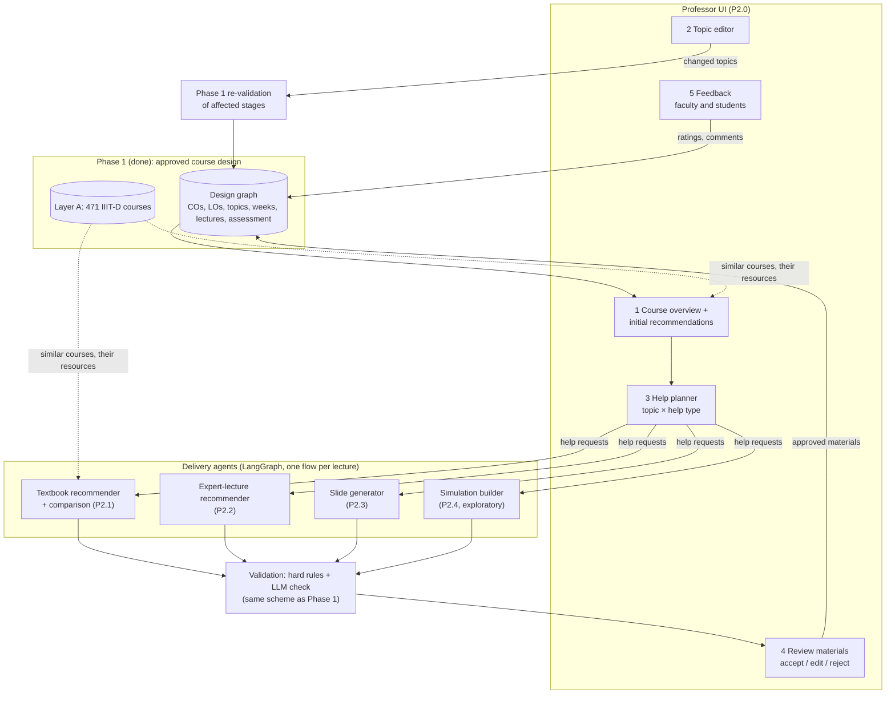

# ProfsAgent — Phase 2 Architecture: Course Delivery
### Approved course design → help the professor asked for, per topic → verified delivery materials, professor in the loop

Status: **DRAFT v0.1, for discussion with the supervisor. Nothing here is built yet.**
Scope: Phase 2 of the course lifecycle (Phase I design → **Phase II delivery** → Phase III assessment). Phase 2 starts
from a course design the professor has approved in Phase 1 and helps them deliver it, week by week.
Out of scope: grading, question items and rubrics (Phase 3); changing the approved outcomes (that is a Phase 1 rerun).

---

## 0. What the supervisor asked for (meeting notes, 21 Oct 2026)

| Item in the notes | Our reading | Status |
|---|---|---|
| "What type of help the agent will provide / suggest" | The professor chooses, **per topic**, which kinds of help they want; the agent provides only those | Core of this design |
| Lecture slides | A slide deck per lecture, built from the design (topics, LOs, sources) | P2.3 |
| Good-quality available lectures by experts | Recommend existing recorded lectures (NPTEL, MIT OCW, university channels) that match the topic and level | P2.2 |
| Recommend textbooks, compare them | A short list of books with a comparison table: which course topics each covers, level, edition, availability | P2.1 |
| "Clone delivered lecture" | **Unclear — needs the supervisor's meaning.** Options in §8 | Open question |
| "Simulation ??" | Interactive demos for suitable topics; the supervisor marked it uncertain | P2.4, exploratory |
| Professor in the loop | The professor approves every material before it is used | Gates in every flow |
| UI: initial recommendation for the course (and similar courses) | First screen: the design, similar IIIT-D and external courses, and suggested help | P2.0 |
| UI: allow the professor to modify topics | Topic editor; a change re-runs Phase 1 validation on what it affects | P2.0 |
| UI: specify what type of help, in what topic | The help planner (topic × help type) | P2.0 |

Action point 3 (feedback from faculty and students across design and delivery) is built in as the **feedback loop** (§6).

---

## 1. Architecture overview



Three rules carry over from Phase 1:
1. **The graph is the course.** Every material is a node linked to the lecture and the LOs it serves, with its source.
2. **The agent proposes, checks decide, the professor approves.** No material reaches students without approval.
3. **Only what was asked for is generated.** The help planner limits the work (and the API cost) to the topics and
   kinds of help the professor chose.

---

## 2. Data model: additions to the design graph (Layer B)

The Stage 1 schema already reserves `Material` (`W05.L2/MAT1`). Phase 2 adds:

| Node | local_id | Main fields |
|---|---|---|
| `HelpRequest` | `HR:M2.T1` | topic, help_types[] (slides, expert_lecture, textbook, simulation, other), note, requested_by, at |
| `Material` | `W05.L2/MAT1` | kind (slides, video, chapter, simulation, notes), title, url or file, source, licence, duration_min, status (proposed, approved, rejected), version |
| `Recommendation` | `REC:…` | candidate (video, book), score, why, verified (bool), problems[] |
| `Feedback` | `FB:…` | by_role (faculty, student), rating 1–5, comment, about (any node), at |

Relationships:

```
(HelpRequest)-[:FOR]->(CourseTopic)
(Lecture)-[:USES {order}]->(Material)
(Material)-[:COVERS_LO]->(LO)            // what the material teaches
(Material)-[:FROM]->(Resource | ExternalRef)   // where it comes from (book, video, page)
(Recommendation)-[:FOR]->(CourseTopic | Lecture)
(Feedback)-[:ABOUT]->(any node)
(Approval)-[:FREEZES]->(Material)
```

This finally gives the design graph a job beyond provenance: a lecture's materials, the LOs they serve and the
feedback on them are all linked, which is also what Phase 3 needs to compute CO attainment.

---

## 3. The professor UI (P2.0)

A small web app; a **Streamlit** prototype first (Python, same codebase, quick to change), moving to FastAPI + a web
front end only if the pilot needs it.

| Screen | What the professor does | What happens |
|---|---|---|
| 1 Course overview | Sees the approved design, similar IIIT-D courses (from the KG) and external comparables, and a suggested help plan | Read-only; suggestions come from the KG and Phase 1 outputs |
| 2 Topic editor | Adds, removes, reorders or renames topics | The change is applied to the design graph and the Phase 1 checks re-run on the affected stages (structure, schedule, assessment); open errors are shown before saving |
| 3 Help planner | Ticks, per topic, the help wanted (slides, expert lectures, textbook chapters, simulation) and adds a note | Creates `HelpRequest` nodes; the agents run only for these |
| 4 Review | Opens each generated or recommended material; accepts, edits or rejects, with a reason | Approved materials are frozen and linked to the lecture |
| 5 Feedback | Faculty and students rate materials and the course plan | Stored as `Feedback` nodes (§6) |

---

## 4. Delivery agents

Each agent is a LangGraph flow (the Phase 1 orchestrator is reused), runs per lecture or topic, and ends at the
professor's review. All of them use the Phase 1 validation scheme: hard rules in code + an LLM check (§5).

### 4.1 Textbook recommender and comparison (P2.1, mostly deterministic)
- **Sources:** OpenLibrary (already used in Phase 1), Google Books API (descriptions and contents where available), the
  resources of similar IIIT-D courses in the KG, and the IIIT-D library catalogue if access is available.
- **Method:** candidate books → each book's chapters (or description) matched to the course topics with the local
  embedding model → a comparison table.
- **Output:** a table per course: book · topics covered (% and which) · level · edition and year · availability ·
  recommended role (primary / reference).
- **Cost:** no LLM needed for matching; one optional LLM call to write the comparison summary.

### 4.2 Expert-lecture recommender (P2.2)
- **Sources:** NPTEL (IIT/IISc courses), MIT OpenCourseWare, Stanford / CMU / university YouTube channels, through the
  YouTube Data API and the Google-Search grounding Phase 1 already uses for external courses.
- **Method:** search per topic → candidates → **verification**: the link resolves, the channel is on an institution
  whitelist, the duration is known, and the title, description and (where available) transcript match the topic and its
  LOs (embedding similarity above a calibrated threshold) → an LLM check for level fit.
- **Output:** 1–3 recommended videos per requested topic, each with why it was chosen and which LOs it covers.

### 4.3 Slide generator (P2.3)
- **Method:** a structured slide outline per lecture (title, slides with bullet points, speaker notes, suggested figures,
  the LO each slide serves, sources) generated from the lecture's topics, LOs and the approved textbook chapters →
  rendered to an editable **PowerPoint (python-pptx)** file and a PDF.
- **Checks:** every LO of the lecture is covered by at least one slide; the number of slides fits the lecture hours;
  every factual slide cites an approved source; an LLM check compares the content with the sources and the level.

### 4.4 Simulation builder (P2.4, exploratory)
- For topics where a demo helps (algorithms, scheduling, networking, data structures): either link an existing
  interactive resource (e.g. VisuAlgo, PhET) or generate a small, self-contained notebook or HTML demo.
- **Checks:** the demo runs offline in a sandbox and covers the topic's LO. Kept small until the supervisor confirms the
  scope ("simulation ??" in the notes).

---

## 5. Validation in Phase 2

The same two-part scheme as Phase 1 (`config/validation.yaml`, profile `llm`):

| Hard rules (code) | LLM check (checklist) |
|---|---|
| Every LO of a lecture is covered by at least one approved material | Content is correct and agrees with its sources |
| Every link resolves; every video's duration is known and within a cap | Level fits the course and the students |
| Every book and video is verified against a record (library, YouTube, OCW) | The material really teaches the LO it claims |
| Slide count fits the lecture hours | Slides are clear and not overloaded |
| Sources and licences are recorded for anything reused | Recommendations are better than the obvious alternatives |
| Nothing references topics outside that week's plan | |

Gate per week: the professor approves the week's materials before they are released.

---

## 6. Feedback loop (action point 3)

- **Before building:** two short questionnaires, one for faculty and one for students, on what help they expect from
  course design to delivery (what they spend time on, what they would trust an agent with, what they would never
  delegate). Results decide the order of P2.1–P2.4.
- **During use:** ratings and comments on materials (`Feedback` nodes). Low-rated materials are flagged for
  regeneration; recurring complaints become new checks (the same "every escaped failure becomes a rule" loop as Phase 1).
- **Across the lifecycle:** delivery feedback and, later, Phase 3 attainment feed into the next Phase 1 design of the
  course.

---

## 7. Tools

| Need | Tool | Notes |
|---|---|---|
| Orchestration, professor gates | LangGraph (existing) | One flow per lecture; `interrupt()` for review |
| Generation | Gemini (existing roles) | Free tier: ~20 requests/day/model; the help planner keeps calls to what was asked |
| Matching topics to chapters, videos | sentence-transformers all-MiniLM-L6-v2 (existing, local) | Free, offline |
| Graph | Neo4j (existing) | New node types in §2 |
| Books | OpenLibrary (existing), Google Books API | Google Books needs an API key (the professor or team adds it to `.env`) |
| Videos | YouTube Data API v3, NPTEL / MIT OCW via search grounding | YouTube key needed; ~100 searches/day on the free quota |
| Slides | python-pptx | New dependency (installed only after approval) |
| Simulations | nbformat (notebooks) or single-file HTML | Exploratory |
| UI | Streamlit | Prototype |
| Feedback forms | Google Forms (questionnaires); `Feedback` nodes in the app | |

---

## 8. Open questions for the supervisor

1. **"Clone delivered lecture" — which meaning?**
   (a) Reuse a lecture already delivered at IIIT-D on the same topic (the KG knows which courses teach it) and adapt it;
   (b) turn the professor's own past lecture (slides or recording) into a reusable, updated package;
   (c) an AI voice or avatar that delivers the lecture. (a) and (b) fit this design; (c) raises consent and quality
   questions and is out of scope unless the supervisor wants it.
2. **Simulations:** which kinds of topics, and is linking existing demos enough?
3. **Where do approved materials go?** A download, Google Classroom, or the IIIT-D LMS?
4. **Reuse policy:** may recommended external slides or videos be redistributed, or only linked?
5. **Pilot:** which professor and course try Phase 2 first?

---

## 9. Plan

| Step | Deliverable | Depends on |
|---|---|---|
| P2.0 | Data model additions, Streamlit UI: overview, topic editor (with Phase 1 re-validation), help planner | Phase 1 design graph |
| P2.1 | Textbook recommender + comparison table | P2.0 |
| P2.2 | Expert-lecture recommender with verification | P2.0, a YouTube API key |
| P2.3 | Slide generator (outline → PPTX) with checks | P2.1 (approved chapters as sources) |
| P2.4 | Simulation builder (exploratory) | Supervisor's answer to §8.2 |
| P2.5 | Feedback questionnaires and in-app feedback; evaluation (acceptance rate, ratings, time saved) | Runs in parallel from the start |
