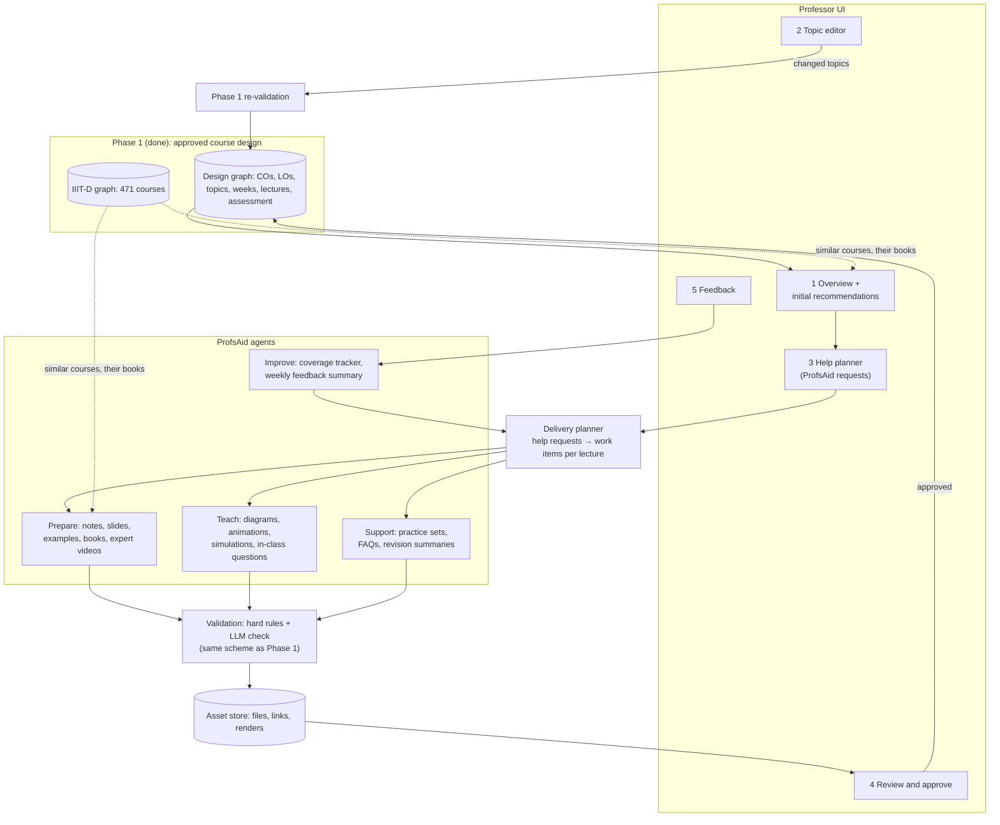

# ProfsAgent — Phase 2 Architecture: Course Delivery and ProfsAid
### Approved course design → the help the professor asks for, per topic → checked materials, professor in the loop

Status: **DRAFT v0.2 (21 Oct 2026), for discussion with the supervisor. Nothing here is built yet.**
Scope: Phase 2 of the course lifecycle (Phase I design → **Phase II delivery** → Phase III assessment). Phase 2 starts
from a course design approved in Phase 1 and helps the professor deliver it, week by week.
Out of scope: question papers, marking rubrics and grading (Phase 3); changing approved outcomes (a Phase 1 rerun).

**ProfsAid** is the name used here for the professor-assistance layer: the catalogue of help a professor can ask for,
the agents that produce it, and the checks and review around it (section 3).

---

## 0. What the supervisor asked for (meeting notes, 21 Oct 2026)

| Item in the notes | Our reading | Where in this plan |
|---|---|---|
| "What type of help the agent will provide / suggest" | The professor chooses, per topic, which help they want; the agent provides only that | ProfsAid catalogue (§3), help planner (§5) |
| Lecture slides | A slide deck per lecture, built from the design | Aid P2 (§3) |
| Good-quality available lectures by experts | Recommend existing recorded lectures (NPTEL, MIT OCW, university channels) | Aid P5 (§3) |
| Recommend textbooks, compare them | A comparison table: topics each book covers, level, edition, availability | Aid P4 (§3) |
| "Clone delivered lecture" | **Unclear — needs the supervisor's meaning** (options in §11) | Open question |
| "Simulation ??" | Interactive demos and visual explanations for suitable topics | §4, researched |
| Professor in the loop | The professor approves every material before use | Review gate (§6) |
| UI: initial recommendation for the course (and similar courses) | First screen: the design, similar IIIT-D and external courses, suggested help | §5 screen 1 |
| UI: allow the professor to modify topics | Topic editor; a change re-runs the Phase 1 checks on what it affects | §5 screen 2 |
| UI: specify what type of help, in what topic | Help planner: topic × help type | §5 screen 3 |
| Action point 3: feedback from faculty and students | Questionnaires before building; ratings during use | §8 |

---

## 1. Architecture overview



Rules carried over from Phase 1:
1. **The graph is the course.** Every material is a node linked to the lecture and LOs it serves, with its source.
2. **The agent proposes, checks decide, the professor approves.** Nothing reaches students unapproved.
3. **Only what was asked for is made.** The help planner limits work and API cost to the topics and aids chosen.
4. **Numbers and facts are checked in code** (links resolve, books exist, counts fit the hours); judgement items
   (clarity, level, correctness against sources) go to an LLM check and then to the professor.

---

## 2. Components

| Component | Job | Built from |
|---|---|---|
| Professor UI | Overview, topic editor, help planner, review, feedback | Streamlit prototype (§9) |
| Delivery planner | Turns help requests into work items per lecture and week, in teaching order, within an AI-call budget | Code + the design graph |
| ProfsAid agents | One agent per aid (§3); each a LangGraph flow ending at the professor's review | Existing orchestrator |
| Retrieval | Finds textbooks, chapters, expert videos, existing simulations | OpenLibrary, Google Books, YouTube Data API, search grounding, the IIIT-D graph |
| Renderers | Turn generated specs into files: slides, diagrams, animations, simulations | python-pptx, Mermaid/Graphviz, Manim, a headless browser |
| Validation | Hard rules + LLM checklist per aid (§6) | Phase 1 scheme, new checklists |
| Asset store | Generated files, renders, links, with versions | Run folder + `Material` nodes |
| Feedback and tracking | Ratings, comments, what was actually taught | `Feedback` nodes, coverage tracker |

---

## 3. ProfsAid: the help a professor can ask for

Grouped by when it helps. The professor ticks aids per topic in the help planner; each aid lists what it needs, what it
produces and how it is checked. "AI calls" are per topic or lecture on the free tier.

| # | Aid | When | Produces | Main tools | Checked by | AI calls |
|---|---|---|---|---|---|---|
| P1 | Lecture notes outline | Prepare | Ordered talking points per lecture, tied to its LOs, with sources | LLM + approved books | Every LO covered; claims cite a source | 1 |
| P2 | Slides | Prepare | Editable PowerPoint + PDF | LLM outline → python-pptx | Every LO covered; slide count fits the hours; sources cited | 1–2 |
| P3 | Worked examples and problem sets | Prepare / Support | Problems with step-by-step solutions at the LO's Bloom level | LLM | Solutions checked (code run or recomputed where possible); level matches | 1–2 |
| P4 | Textbooks and chapters + comparison | Prepare | Comparison table: topics covered per book, level, edition, availability | OpenLibrary, Google Books, IIIT-D graph, local embeddings | Book exists (library record); chapter–topic match | 0–1 |
| P5 | Expert lecture videos | Prepare | 1–3 videos per topic with why and which LOs | YouTube Data API, NPTEL / MIT OCW | Link works; channel on a whitelist; transcript matches the topic | 0–1 |
| T1 | Diagrams | Teach | Flowcharts, state machines, trees, graphs, architectures | LLM → Mermaid / Graphviz text → render | Renders; labels use the topic's terms | 1 |
| T2 | Animations | Teach | Short narrated animations for a concept | LLM → Manim code → render | Renders; expert review (§4) | 2–4 |
| T3 | Interactive simulations | Teach | A single-file web demo with controls, or an embedded existing one | LLM → HTML/JS, or PhET / VisuAlgo / Python Tutor | Runs offline; controls change the output; no network calls (§4) | 1–3 |
| T4 | In-class questions | Teach | Quick polls and "predict, then see" questions per lecture | LLM | One correct answer; distractors plausible; tied to an LO | 1 |
| S1 | Revision summaries and FAQs | Support | One-page summaries; answers to common questions from feedback | LLM + feedback | Consistent with the notes and sources | 1 |
| S2 | Lab handouts | Support | Step-by-step lab sheets from the Phase 1 lab plan | LLM | Steps runnable; tools match the lab plan | 1–2 |
| I1 | Coverage tracker | Improve | What was taught vs the plan; re-plans when a lecture slips | Code | Every LO still taught before it is assessed | 0 |
| I2 | Weekly feedback summary | Improve | Themes from student and faculty feedback | LLM | Quotes traceable to feedback | 1 |
| ? | "Clone delivered lecture" | Prepare | Depends on the supervisor's meaning (§11) | — | — | — |

Rough cost: a 13-week course where help is requested on 8 topics (slides + one visual each) needs about 16–40 AI
calls in total, spread over the weeks; the planner keeps each day within the free quota.

---

## 4. Simulations and visual representations (research summary)

### 4.1 What the evidence says
- **What students do with a visual matters more than what it shows.** A meta-study of 24 experiments on algorithm
  visualization found the learners' activities more important than the visualization's content, and active engagement
  more effective than watching ([Hundhausen, Douglas & Stasko, 2002](https://www.academia.edu/15636659/A_Meta_Study_of_Algorithm_Visualization_Effectiveness)).
- **Design for an engagement level.** The engagement taxonomy runs no viewing → viewing → responding → changing →
  constructing → presenting ([Naps et al., 2002](https://rex.libraries.wsu.edu/esploro/outputs/journalArticle/Exploring-the-role-of-visualization-and/99900547176001842)).
  Every visual ProfsAid makes should come with a task at "responding" or above: a prediction to make, a parameter to
  change, a question to answer.
- **LLM-made animations can teach well, with expert review.** In LLM2Manim, 100 undergraduates learned with
  LLM-generated animations or PowerPoint: post-test 83% vs 78%, learning-gain effect size d = 0.67, engagement d = 0.94,
  lower cognitive load; experts reviewed the output before rendering because the LLM was not always correct
  ([LLM2Manim](https://arxiv.org/abs/2604.05266)). Related systems:
  [Manimator](https://arxiv.org/pdf/2507.14306) (paper or prompt → scene description → Manim code) and
  [PhysicsSolutionAgent](https://arxiv.org/pdf/2601.13453), which reports code hallucinations and LaTeX errors as the
  main failure modes and reduces them with retrieval over the Manim documentation.
- **Generated interactive web apps need an interactivity check.** Code-generation benchmarks only check that output
  compiles; [I-WebGenBench](https://arxiv.org/pdf/2606.00750) evaluates LLM-generated scientific web applications for
  real interactivity (controls that change what is shown).
- **Ready-made simulations exist for many topics.** PhET simulations are free to embed with attribution under CC BY 4.0
  (commercial use needs a licence) ([PhET](https://phet.colorado.edu/vi/help-center/getting-started)); VisuAlgo and
  Python Tutor cover data structures, algorithms and code execution
  ([study using both](https://politehnika.uniri.hr/index.php/politehnika/article/view/53)).

### 4.2 Options, from cheapest and most reliable to richest

| Type | Example (CS course) | How it is made | Reliability | Cost and setup |
|---|---|---|---|---|
| Link an existing simulation | VisuAlgo sorting, PhET circuits, Python Tutor trace of the lecture's code | Search + whitelist; no generation | High (expert-built) | Free; no install |
| Diagram from text | State machine for TCP, a class diagram, a recursion tree | LLM writes Mermaid / Graphviz text → rendered in code | High: if it parses, it renders; labels checked | 1 call; no heavy install |
| Chart or plot | Complexity curves, a scheduling Gantt chart | LLM writes a small plotting script → run in a sandbox | High | 1 call; matplotlib |
| Interactive web simulation | Sliders for a hash table's load factor, a step-through of Dijkstra | LLM writes one self-contained HTML/JS file (plain canvas, p5.js or D3) | Medium: must be tested in a headless browser | 1–3 calls; a headless browser for checks |
| Notebook demo | Runnable cells comparing algorithms | LLM writes a notebook; runs in the browser with Pyodide / JupyterLite | Medium | 1–2 calls |
| Animation | Gradient descent, a sorting animation with narration | LLM writes Manim code → rendered to video | Lower: needs expert review; rendering takes minutes | 2–4 calls; Manim + ffmpeg + LaTeX install |

### 4.3 How a generated simulation is made and checked
1. **Spec first.** From the topic, its LOs and the approved notes, the LLM writes a short spec: what is shown, which
   controls, what the student should predict, and the engagement task.
2. **Generate.** One self-contained file (no external scripts, no network), or Mermaid/Manim code.
3. **Hard checks (code):** it parses or renders without errors; in a headless browser, the page loads with no console
   errors and each control changes the display (the interactivity check); no network requests; file size within limits.
4. **LLM check:** the behaviour matches the concept and the sources (e.g. the hash table really resizes at the load
   factor shown); labels use the course's terms.
5. **Repair:** only the failing part is regenerated, as in LLM2Manim; at most 2 rounds.
6. **Professor review** before students see it; approved visuals are frozen and linked to the lecture and LOs.

**Recommendation:** start with links to existing simulations and diagrams-from-text (cheap and reliable), then
single-file interactive simulations for 2–3 pilot topics, and add Manim animations only if the pilot shows demand,
because of the install and review cost.

---

## 5. The professor UI

| Screen | What the professor does | What happens |
|---|---|---|
| 1 Overview | Sees the approved design, similar IIIT-D and external courses, and a suggested help plan | Suggestions from the IIIT-D graph and Phase 1 outputs |
| 2 Topic editor | Adds, removes, reorders or renames topics | Saved to the design graph; the Phase 1 checks re-run on structure, schedule and assessment; open errors shown before saving |
| 3 Help planner | Ticks ProfsAid items per topic (a topic × aid grid), adds a note, sets a weekly AI budget | Creates `HelpRequest` nodes; the delivery planner schedules the work |
| 4 Review | Opens each item; accepts, edits or rejects with a reason | Approved items are frozen and linked to the lecture |
| 5 Feedback | Faculty and students rate items and the plan | `Feedback` nodes; feeds the weekly summary and the improvement loop |

---

## 6. Validation in Phase 2

Same two-part scheme as Phase 1: hard rules in code + an LLM checklist, then the professor's gate per week.

| Hard rules (code) | LLM checklist |
|---|---|
| Every LO of a lecture is covered by at least one approved item | Content is correct and agrees with its sources |
| Every link resolves; every book and video exists in a record (library, YouTube, OCW) | Level fits the course and students |
| Slide count and video length fit the lecture hours | The item really teaches the LO it claims |
| Diagrams parse; simulations load without errors, respond to their controls and make no network calls | Visuals show the concept correctly |
| Worked solutions recompute or run | Questions have one right answer and plausible distractors |
| Sources and licences recorded for reused content | Clear, not overloaded |

---

## 7. Data model: additions to the design graph

The Stage 1 schema reserves `Material` (`W05.L2/MAT1`). Phase 2 adds:

| Node | local_id | Main fields |
|---|---|---|
| `HelpRequest` | `HR:M2.T1` | topic, aids[] (P1–I2), note, requested_by, at |
| `Material` | `W05.L2/MAT1` | kind (notes, slides, problems, chapter, video, diagram, animation, simulation, question, handout), title, file or url, source, licence, engagement task, status, version |
| `Recommendation` | `REC:…` | candidate (book, video, simulation), score, why, verified, problems[] |
| `Feedback` | `FB:…` | by_role, rating 1–5, comment, about, at |
| `TaughtLecture` | `W05.L2/TAUGHT` | date, what was covered, what slipped |

```
(HelpRequest)-[:FOR]->(CourseTopic)
(Lecture)-[:USES {order}]->(Material)-[:COVERS_LO]->(LO)
(Material)-[:FROM]->(Resource | ExternalRef)
(Recommendation)-[:FOR]->(CourseTopic | Lecture)
(Feedback)-[:ABOUT]->(any node)
(Lecture)-[:DELIVERED_AS]->(TaughtLecture)
```

This gives the design graph its main job: materials, feedback and what was taught all hang off the same lectures and
LOs, which is also what Phase 3 needs to compute CO attainment.

---

## 8. Feedback loop (action point 3)

- **Before building:** two short questionnaires (faculty, students) on expectations from design to delivery: what takes
  their time, which aids they would trust, which they would never delegate. The results set the order of §10.
- **During use:** ratings and comments on each item; low ratings flag the item for regeneration; recurring complaints
  become new checks (the Phase 1 "every escaped failure becomes a rule" loop).
- **Across the lifecycle:** delivery feedback and, later, Phase 3 attainment feed the next Phase 1 design of the course.

---

## 9. Tools

| Need | Tool | Status / cost |
|---|---|---|
| Orchestration, review gates | LangGraph | Existing |
| Generation | Gemini (existing roles) | Free tier ~20 requests/model/key/day; more keys being added |
| Matching topics to chapters, videos, simulations | sentence-transformers all-MiniLM-L6-v2 | Existing, local, free |
| Graph | Neo4j | Existing |
| Books | OpenLibrary; Google Books API | OpenLibrary existing; Google Books needs a key |
| Videos | YouTube Data API v3; NPTEL / MIT OCW via search grounding | Needs a YouTube key; grounding needs a working search model (gemini-2.5-flash is unavailable on current keys) |
| Slides | python-pptx | New install (ask first) |
| Diagrams | Mermaid CLI or Graphviz | New install (ask first) |
| Animations | Manim + ffmpeg + LaTeX | Large install; only after the pilot |
| Simulation checks | A headless browser (Playwright) | New install (ask first) |
| Notebooks | Pyodide / JupyterLite | Browser-side, later |
| UI | Streamlit | New install (ask first) |
| Questionnaires | Google Forms | No install |

---

## 10. Plan

| Step | Deliverable | Depends on |
|---|---|---|
| P2.0 | Data model additions; Streamlit UI: overview, topic editor (with Phase 1 re-validation), help planner | Approved design graph; Streamlit install |
| P2.1 | Feedback questionnaires out to faculty and students | Nothing; start now |
| P2.2 | Textbooks and chapter comparison (P4) | P2.0 (or a command-line first version) |
| P2.3 | Expert lecture videos (P5) | A YouTube API key |
| P2.4 | Notes outline and slides (P1, P2) | P2.2 (approved books as sources) |
| P2.5 | Visuals: existing-simulation links + diagrams (T1), then 2–3 pilot interactive simulations (T3) | Headless browser for checks |
| P2.6 | In-class questions, problem sets, handouts, summaries (T4, P3, S1, S2) | P2.4 |
| P2.7 | Coverage tracker and weekly feedback summary (I1, I2) | Feedback in use |
| Later | Animations (T2) | Pilot demand |

---

## 11. Open questions for the supervisor

1. **"Clone delivered lecture" — which meaning?** (a) reuse a lecture already given at IIIT-D on the same topic (the
   graph knows which courses teach it) and adapt it; (b) turn the professor's own past lecture (slides or recording)
   into an updated package; (c) an AI voice or avatar delivering the lecture. (a) and (b) fit this design; (c) raises
   consent and quality questions.
2. **Simulations:** which topics matter most, and is linking existing ones acceptable where they exist?
3. **ProfsAid scope:** are the aids in §3 the right set? Which three first?
4. **Where do approved materials go?** Download, Google Classroom, or the IIIT-D LMS?
5. **Reuse policy** for external slides, videos and simulations: link only, or redistribute with licence?
6. **Pilot:** which professor and course?
7. **Should AI findings block, or only advise the professor?** (from the Phase 1 validation comparison)

---

## Sources
- [Hundhausen, Douglas & Stasko (2002), A Meta-Study of Algorithm Visualization Effectiveness](https://www.academia.edu/15636659/A_Meta_Study_of_Algorithm_Visualization_Effectiveness)
- [Naps et al. (2002), Exploring the role of visualization and engagement in CS education](https://rex.libraries.wsu.edu/esploro/outputs/journalArticle/Exploring-the-role-of-visualization-and/99900547176001842)
- [LLM2Manim: human-in-the-loop LLM animations, 100-student study](https://arxiv.org/abs/2604.05266)
- [Manimator: research papers to visual explanations](https://arxiv.org/pdf/2507.14306)
- [PhysicsSolutionAgent: failure modes of generated Manim code](https://arxiv.org/pdf/2601.13453)
- [I-WebGenBench: interactivity in LLM-generated scientific web applications](https://arxiv.org/pdf/2606.00750)
- [PhET: licence and embedding](https://phet.colorado.edu/vi/help-center/getting-started)
- [Sorting with VisuAlgo and Python Tutor in online teaching](https://politehnika.uniri.hr/index.php/politehnika/article/view/53)
- [AI-generated slides: are they good, can students tell?](https://arxiv.org/pdf/2605.13532)
- [LecturaAgents: syllabus-based materials with a syllabus-coverage metric](https://arxiv.org/pdf/2606.16428)
