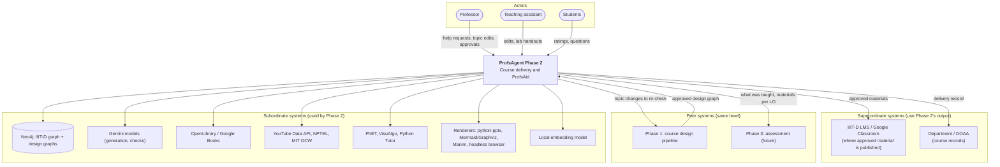
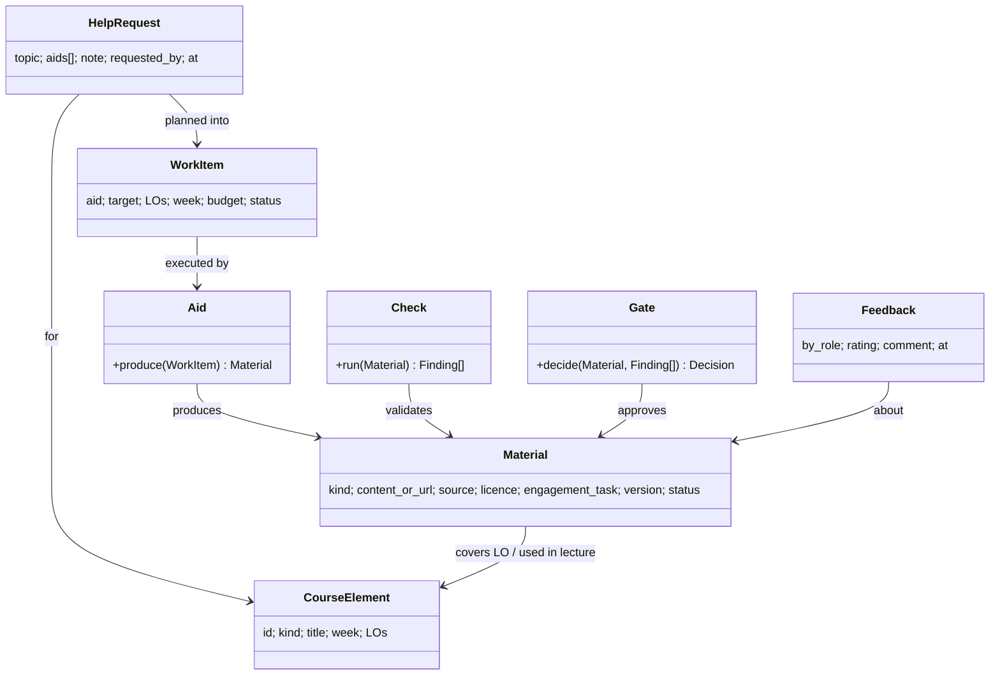
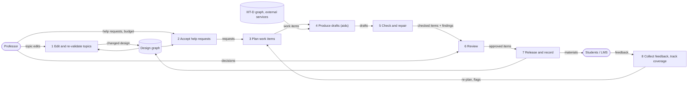
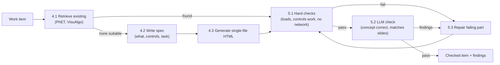
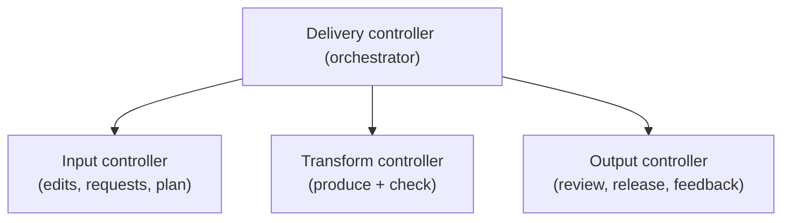

# ProfsAgent Phase 2 (Course Delivery and ProfsAid) — Architectural Design

Status: **DRAFT v0.1, 21 Oct 2026.** Structured after the architectural-design method in Pressman's *Software
Engineering* (architecture and views, decisions, genre, styles, patterns, context diagram, archetypes, components,
instantiation, ATAM, complexity, data-flow mapping). Companion to `02_phase2_architecture.md`, which holds the
ProfsAid catalogue and the research on simulations and visuals.

---

## 1. Software architecture

### 1.1 What the architecture is
Phase 2 takes a course design the professor approved in Phase 1 (outcomes, topics, a 13-week lecture plan, labs and an
assessment plan) and helps the professor **deliver** it: it produces the help the professor asks for, per topic, such
as slides, worked problems, textbook comparisons, expert videos, diagrams and simulations. Everything is checked
before the professor reviews and approves it.

The architecture is the structure of that system: its components, their externally visible properties, and how they
relate. It is a blueprint, not the software. It lets us analyse whether the design meets its requirements, compare
alternatives while changes are cheap, and reduce construction risk.

### 1.2 Why it matters here
- **Communication:** the supervisor, the professors, Amit (knowledge graph) and Vihan (pipeline) share one picture of
  how Phase 2 joins Phase 1.
- **Early decisions with lasting effect:** where validation sits, what the professor controls, and how API cost is
  bounded are fixed here and shape every later module.
- **Transferability:** the same structure (plan → generate → check → repair → approve) is reused from Phase 1 and can be
  reused in Phase 3 (assessment).

### 1.3 Requirements the architecture must meet

| ID | Requirement | Kind |
|---|---|---|
| R1 | The professor decides which help is produced, for which topics | Functional |
| R2 | Every produced item is linked to the lecture and learning outcomes (LOs) it serves | Functional |
| R3 | Nothing reaches students without the professor's approval | Functional |
| R4 | Facts are checked in code: links resolve, books and videos exist, items fit the lecture time | Quality: correctness |
| R5 | Judgement items (accuracy, level, clarity) are checked before the professor sees them | Quality: correctness |
| R6 | API use stays within the free tier (about 20 requests per model per key per day) | Quality: cost |
| R7 | A failed AI call or service never loses approved work | Quality: reliability |
| R8 | A professor without technical training can use it | Quality: usability |
| R9 | Changing a topic re-checks the Phase 1 design it affects | Functional |
| R10 | Feedback from professors and students improves later output | Functional |

---

## 2. Architectural description (stakeholders and views)

Following the IEEE recommended practice for architectural description, each view answers one stakeholder's concern.

| Stakeholder | Concern | View that answers it |
|---|---|---|
| Professor | What can I ask for, what do I get, what must I approve? | Context view (§7.1), professor-input view (§9), output view (§10) |
| Students | Is the material correct, at my level, and actually useful? | Validation view (§11), feedback loop (§11.4) |
| Supervisor / department | Does it follow IIIT-D's template and outcome-based education? Is it safe to pilot? | Decisions (§3), ATAM (§12) |
| Developers (team) | Which component does what; where do I add an aid? | Layer view (§8), component view (§7.3), data-flow view (§13) |
| Knowledge-graph owner | What does Phase 2 read and write in Neo4j? | Data layer (§8.6), archetypes (§7.2) |

---

## 3. Architectural decisions

Each decision records the alternatives considered and why the chosen option best meets the concerns above.

| # | Decision | Alternatives considered | Chosen because |
|---|---|---|---|
| D1 | The approved Phase 1 design graph is the single source of truth | Free-text proposal as input | Every item can be linked to a lecture and LO (R2); Phase 3 can compute attainment from the same links |
| D2 | The professor requests help per topic (help planner) | Generate everything for every lecture | Professor control (R1); bounded cost (R6): 16–40 calls per course instead of hundreds |
| D3 | One agent per kind of help, behind a common interface | One large prompt for the whole delivery pack | Each aid can be checked, repaired and improved separately; failures stay local (R7) |
| D4 | Validation = hard rules in code + an LLM checklist, then the professor | LLM check only; rules only | Phase 1 measurement: rules alone 23/23 on exact defects but blind to judgement; LLM alone 10/23; both together 23/23 plus 2 real problems found |
| D5 | Every item passes a review gate before release | Auto-publish items that pass the checks | R3; AI checks vary run to run (only 44% overlap in what they list) |
| D6 | Prefer linking expert-made resources over generating (videos, PhET / VisuAlgo simulations) | Always generate | Cheaper and more reliable; generation reserved for gaps |
| D7 | Visuals come with an engagement task (predict, change, answer) | Visuals to watch | Evidence: what learners do with a visualization matters more than its content |
| D8 | External services sit behind adapters with fallbacks and quotas | Call services directly from agents | Models get retired (gemini-2.5-flash returned "not available" on all keys); one place to change |
| D9 | A prototype UI in Streamlit | A full web front end | Same language as the codebase; fast to change during the pilot |

---

## 4. Architectural genre

Phase 2 belongs to two genres in Booch's classification:
- **Artificial intelligence:** a system that augments human cognition, here the professor's preparation and teaching.
- **Content management:** it produces, versions, reviews and publishes teaching material.

The genre explains two features: a human stays in control of every decision (AI genre), and every artefact has a
version, a status and an approval trail (content-management genre).

---

## 5. Architectural styles

No single style fits, so Phase 2 combines four, each where it serves best.

| Style | Where it is used | Why |
|---|---|---|
| **Data-centred (repository)** | The design graph in Neo4j is the central store; the planner, agents, validators and UI all read and write it | All components share one consistent picture of the course; new aids can be added without changing the others |
| **Data-flow (pipes and filters)** | Inside every aid: spec → generate → hard checks → LLM check → repair → render | Each filter is small, testable and replaceable; a failing filter stops the item, not the system |
| **Call and return (main program / subprogram)** | The orchestrator calls the planner, then each aid, then the gate | Clear control: one controller decides what runs next and when the professor is asked |
| **Layered** | Presentation → application → aid services → validation → integration → data (§8) | Each layer depends only on the one below; the UI can change without touching agents; services can be swapped without touching the UI |

### 5.1 Organization and refinement
- **Control:** control lives in the orchestrator (application layer). Agents never call each other; they return results
  to the orchestrator. Control is handed to the professor at gates and resumes on their decision.
- **Data:** data flows through the repository (design graph + asset store). Agents receive data from the planner and
  write results back; data between filters inside an aid moves as typed JSON objects, validated at each step.

---

## 6. Architectural patterns

| Pattern | Problem it solves | In Phase 2 |
|---|---|---|
| Generator–critic loop | AI output can be wrong | Each aid is followed by checks; a failing part is repaired, at most 2 rounds |
| Human-in-the-loop gate | Unchecked material must not reach students | Review screen; approve, edit or reject with a reason |
| Planner–executor | Many requests, limited daily quota | The delivery planner orders work by teaching week and spreads it within the budget |
| Repository | Many components need the same course data | Neo4j design graph + asset store |
| Adapter + fallback chain | External services fail, change or retire models | LLM client and service adapters with retries, cooldowns and alternatives |
| Retrieve before generate | Generated material can be invented | Aids look for approved books, expert videos and existing simulations first |

---

## 7. Architectural design

### 7.1 Representing the system in context (architectural context diagram)

| Entity | Relationship | Data exchanged |
|---|---|---|
| Professor (actor) | Main user | Help requests, topic edits, budget, review decisions, feedback |
| Teaching assistant (actor) | Helper | Edits to handouts and problem sets; review on the professor's behalf if allowed |
| Students (actor) | Consumers | Ratings and questions on released material |
| IIIT-D LMS / Google Classroom (superordinate) | Receives approved material | Files and links per week |
| Department / DOAA (superordinate) | Receives records | What was delivered, per course |
| Phase 1 (peer) | Supplies the design; re-checks changed topics | Design graph; validation results |
| Phase 3 (peer, future) | Uses delivery data | Materials per LO; what was actually taught |
| Neo4j, Gemini, book and video services, simulation sites, renderers, embeddings (subordinate) | Services Phase 2 calls | Queries, prompts, files |

### 7.2 Archetypes

An archetype is an abstraction representing a core element of the system's behaviour. Phase 2 needs eight.

| Archetype | Represents | Key responsibilities |
|---|---|---|
| **CourseElement** | A part of the approved design: Lecture, Topic, LO, Week | Anchor for everything produced; read-only in Phase 2 except through the topic editor |
| **HelpRequest** | What the professor asked for, for one topic | Lists aids, a note, the requester and time |
| **WorkItem** | One unit of work the planner schedules | Aid type, target lecture and LOs, week, budget, status |
| **Aid** | A producer of help (slides, simulation, …) | Turn a WorkItem into a draft Material, using retrieval and generation |
| **Material** | A produced or recommended item | Content or link, kind, source, licence, engagement task, version, status |
| **Check** | A validator | Return findings (code, severity, parts, message, fix hint) for a Material |
| **Gate** | A decision point for the professor | Show items and findings; record approve / edit / reject with a reason |
| **Feedback** | A rating or comment from a professor or student | Attach to any element; feed improvement |

### 7.3 Refining the architecture into components

```mermaid
flowchart LR
  subgraph PRES["Presentation"]
    UI1[Overview]:::c --- UI2[Topic editor]:::c --- UI3[Help planner]:::c --- UI4[Review]:::c --- UI5[Feedback]:::c
  end
  subgraph APP["Application"]
    ORC[Orchestrator]:::c
    PLN[Delivery planner]:::c
    GATE[Gate manager]:::c
    BUD[Budget manager]:::c
  end
  subgraph AID["Aid services"]
    A1[Notes and slides]:::c
    A2[Problems and questions]:::c
    A3[Books and chapters]:::c
    A4[Expert videos]:::c
    A5[Diagrams]:::c
    A6[Simulations]:::c
    A7[Handouts and summaries]:::c
    A8[Coverage tracker]:::c
  end
  subgraph VAL["Validation"]
    V1[Input checks]:::c
    V2[Hard rules]:::c
    V3[LLM checklist]:::c
    V4[Repair]:::c
    V5[Phase 1 re-validation]:::c
  end
  subgraph INT["Integration"]
    I1[LLM client]:::c
    I2[Retrieval adapters]:::c
    I3[Renderers]:::c
    I4[Sandbox and headless browser]:::c
  end
  subgraph DATA["Data"]
    D1[(Design graph)]:::d
    D2[(IIIT-D graph)]:::d
    D3[(Asset store)]:::d
    D4[(Run state and logs)]:::d
  end
  PRES --> APP --> AID --> VAL --> INT --> DATA
  APP --> VAL
  classDef c fill:#eef,stroke:#557;
  classDef d fill:#efe,stroke:#575;
```

Each component, with its interface:

| Component | Layer | Input | Output |
|---|---|---|---|
| Overview | Presentation | Design graph, similar courses | Screen with a suggested help plan |
| Topic editor | Presentation | Professor's topic changes | Proposed change → Phase 1 re-validation → saved or rejected |
| Help planner | Presentation | Topic × aid choices, notes, weekly budget | HelpRequest nodes |
| Review | Presentation | Materials + findings | Decisions with reasons |
| Feedback | Presentation | Ratings, comments | Feedback nodes |
| Orchestrator | Application | Requests, decisions | Calls to planner, aids, gates; run state |
| Delivery planner | Application | HelpRequests, schedule, budget | Ordered WorkItems by teaching week |
| Gate manager | Application | Checked materials | Review queue; frozen approved items |
| Budget manager | Application | AI-call counts, quotas | Allow / defer per WorkItem |
| Aid services (A1–A8) | Aid | A WorkItem + context | A draft Material |
| Input checks | Validation | Professor input | Accepted input or an explained refusal |
| Hard rules | Validation | A Material | Findings (exact facts) |
| LLM checklist | Validation | A Material + sources | Findings (judgement) |
| Repair | Validation | Material + findings | A patched Material (kept only if findings drop) |
| Phase 1 re-validation | Validation | Changed design | Phase 1 findings |
| LLM client | Integration | Prompts | Structured JSON, with fallbacks and cooldowns |
| Retrieval adapters | Integration | Queries | Book, video, simulation candidates with records |
| Renderers | Integration | Specs (slide outline, Mermaid, Manim) | Files (PPTX, SVG, MP4) |
| Sandbox / headless browser | Integration | HTML, code | Run results, interactivity check |
| Design graph, IIIT-D graph, asset store, run state | Data | Writes | Reads |

### 7.4 Describing an instantiation of the system

**Scenario:** Prof. X teaches *Data Structures*. In week 5 the topic is *Hashing* (LOs: CO2.LO1 "Implement a hash table
with chaining for a supplied key set …", CO2.LO2 "Analyse the effect of the load factor …"). In the help planner Prof. X
ticks **slides**, **a textbook chapter** and **a simulation**, and notes "students struggle with the load factor".

1. **Input check:** the topic exists and is approved; the aids are available; the note is stored. HelpRequest created.
2. **Planner:** three WorkItems for week 5 (book first, because slides cite it), budget 4 AI calls, due before week 5.
3. **Books aid:** OpenLibrary and the IIIT-D graph find candidates; local embeddings match chapter titles to *Hashing*;
   hard rule confirms each book's record. Material: "Cormen et al., ch. 11, covers both LOs". No AI call.
4. **Slides aid:** one AI call writes an outline citing ch. 11; python-pptx renders 12 slides (2 h lecture).
   Hard rules: both LOs covered, slide count fits 2 h, every factual slide cites a source. LLM check: content matches the
   chapter; level fits 2nd year. One finding ("slide 7 says resizing happens at load factor 1.0; the cited chapter
   uses 0.75") → repair → re-check passes.
5. **Simulation aid:** retrieval finds a VisuAlgo hash-table visualization (linked, no generation) and, because the note
   mentions the load factor, generates a one-file HTML simulation with a load-factor slider and a task: "predict when the
   table resizes, then try it". Hard checks in a headless browser: loads without errors, the slider changes the table,
   no network calls. LLM check: the resize threshold matches the slides (0.75).
6. **Gate:** Prof. X sees three items and their check results; approves the book and simulation, edits slide 3, approves.
   Items are frozen and linked: `(Lecture W05.L1)-[:USES]->(Material)-[:COVERS_LO]->(CO2.LO2)`.
7. **Release and feedback:** published to the course page; after class, students rate the simulation 4.5/5; two ask
   about open addressing → the weekly summary suggests a short FAQ next week.

---

## 8. Layers in depth

| Layer | Responsibilities | Talks to | Must never |
|---|---|---|---|
| L1 Presentation | Show, collect and explain; every action shows its effect and cost | L2 only | Call AI or external services directly |
| L2 Application | Order the work, keep the budget, manage gates and run state | L3, L4, L6 | Generate content |
| L3 Aid services | Produce draft materials for one WorkItem | L4 (checks), L5 (services), L6 (read context) | Publish or approve |
| L4 Validation | Decide what is wrong and why; repair within limits; re-run Phase 1 checks | L5, L6 | Approve on the professor's behalf |
| L5 Integration | Wrap external services: retries, fallbacks, quotas, sandboxes, renderers | External systems | Hold business rules |
| L6 Data | Store the design graph, IIIT-D graph, assets, run state, logs | — | Lose an approved item (versions kept) |

### 8.1 L1 Presentation
Five screens (overview, topic editor, help planner, review, feedback). Usability rules: plain language, every finding
shown as "what is wrong · where · suggested fix", AI cost shown before a request is confirmed.

### 8.2 L2 Application
The orchestrator is a LangGraph state machine, as in Phase 1, with checkpoints so a run can stop at a gate and resume
days later. The planner schedules by teaching week; the budget manager defers work that would exceed the day's quota.

### 8.3 L3 Aid services
Every aid implements one interface: `produce(WorkItem, context) → Material`, and declares its checks and its AI-call
cost. Adding an aid means adding one service and its checklist, with no change to the other layers.

### 8.4 L4 Validation
Reuses the Phase 1 engine (findings with code, severity, parts, message, fix hint; fixers; repair; gates) with
Phase 2 rule sets and checklists (§11).

### 8.5 L5 Integration
The LLM client already provides structured output, model fallback and cooldowns. New adapters: OpenLibrary/Google
Books, YouTube, simulation sites, renderers, and a sandboxed headless browser for simulations.

### 8.6 L6 Data
Neo4j holds the IIIT-D graph and every course's design graph; Phase 2 adds HelpRequest, WorkItem, Material,
Recommendation, Feedback and TaughtLecture nodes. Files live in the run's asset folder, versioned; Neo4j stores their
paths, hashes and status.

---

## 9. Professor input

| # | Input | When | Through | Validated by | Effect |
|---|---|---|---|---|---|
| I1 | Choose the approved course | Start | Overview | Exists, approved in Phase 1, the professor owns it | Loads the design graph |
| I2 | Edit topics (add, remove, reorder, rename) | Any time | Topic editor | Phase 1 re-validation on structure, schedule, assessment (every LO still taught and assessed, order, hours) | Saved only if no new errors, or with a written reason |
| I3 | Request help per topic | Before each week | Help planner | Topic exists; aid available; within budget; no duplicate request | HelpRequest → WorkItems |
| I4 | Note per request ("students struggle with X") | With I3 | Help planner | Length; no personal data | Passed to the aid as context |
| I5 | Weekly AI budget | Any time | Help planner | Within the configured quota | Planner schedules within it |
| I6 | Preferences (book vs papers, link vs generate, slide style, language level) | Once, editable | Settings | Allowed values | Defaults for all aids |
| I7 | Review decision: approve, edit, reject + reason | Per item | Review | Reason required to reject or to approve an item with open errors | Freeze, edit, or regenerate |
| I8 | What was actually taught | After each lecture | Coverage tracker | Topics exist in the plan | Re-plan if a lecture slipped |
| I9 | Feedback | Any time | Feedback | Rating 1–5; comment length | Weekly summary; improvement loop |

---

## 10. Outputs

| Output | Format | For | Produced by |
|---|---|---|---|
| Delivery pack per lecture | Folder: slides (PPTX, PDF), notes, links, visuals, questions | Professor | Aids A1–A7 |
| Textbook comparison | Table (topics covered, level, edition, availability) | Professor, students | A3 |
| Expert lecture list | 1–3 videos per topic with reasons and LOs | Students | A4 |
| Diagrams and simulations | SVG/PNG, single-file HTML, or a link, each with an engagement task | Students | A5, A6 |
| Problem sets and in-class questions | Document with solutions; question bank | Professor, TA | A2 |
| Validation report per item | Findings under plain headings, as in Phase 1 | Professor | L4 |
| Coverage report | Taught vs planned, by week and LO | Professor, department | A8 |
| Weekly feedback summary | Short report | Professor | A8 |
| Delivery record in the graph | Material, Feedback, TaughtLecture nodes | Phase 3, department | L6 |

---

## 11. How validation works at each step

### 11.1 Step by step

| Step | What happens | Hard rules (code) | LLM check | Professor | If it fails |
|---|---|---|---|---|---|
| S1 Load design | Read the approved design graph | Design exists, approved, no open Phase 1 errors (or overrides recorded) | — | — | Ask the professor to finish Phase 1 |
| S2 Topic edit | Professor changes topics | Phase 1 rules on affected stages: LOs taught and assessed, order, hours, regulation | Phase 1 checklist (llm profile) on the changed stage | Confirms the change | Show findings; save only with a reason |
| S3 Help request | Professor ticks aids | Topic exists; aid available; budget; no duplicate | — | — | Explain and refuse that request |
| S4 Planning | WorkItems ordered by week | Dependencies (books before slides), each item due before its lecture, budget per day | — | Sees the plan and cost | Defer items; never exceed quota |
| S5 Retrieval | Find books, videos, simulations | Record exists (library, YouTube, site); link resolves; licence known; channel whitelisted | Is it relevant and at the right level? | — | Drop candidate; try the next |
| S6 Generation | AI drafts the item | Structure guard: valid JSON in the expected shape, else retry, then the next model | — | — | Mark the WorkItem failed; nothing else affected |
| S7 Item checks | Check the draft | Per aid (§11.2): coverage of LOs, fit to time, sources cited, renders, runs, interactivity | Per-aid checklist (§11.2) | — | Repair (S8) |
| S8 Repair | Fix only failing parts | Kept only if findings strictly drop and no new kind appears; at most 2 rounds | Re-check of the repaired part | — | Send to review with open findings |
| S9 Review gate | Professor decides | Approval with open errors needs a reason | — | Approve / edit / reject | Rejected → regenerate with the reason, or drop |
| S10 Release | Publish to the course page | Only approved, frozen versions; links still resolve; file sizes within limits | — | — | Hold and tell the professor |
| S11 After class | Feedback and coverage | Taught topics vs plan; every LO still taught before it is assessed | Themes in comments | Reads the summary | Re-plan; flag low-rated items |

### 11.2 Checks per aid

| Aid | Hard rules | LLM checklist |
|---|---|---|
| Notes and slides | Every LO of the lecture covered; slide count fits the hours (about 1 slide per 2–4 minutes); each factual slide cites an approved source; renders to PPTX and PDF | Accurate against the source; level fits the course year; one idea per slide; no overload |
| Problems and questions | Solutions recompute or the code runs; one correct option per multiple-choice question; Bloom level matches the LO | Clear wording; distractors plausible; not trivial |
| Books and chapters | Book exists in a library record; chapter titles match the topic (embedding similarity above a threshold) | Level and edition suitable |
| Expert videos | Link resolves; channel on the whitelist; duration known and within a cap; transcript matches the topic | Explains the LO, not just mentions it |
| Diagrams | Mermaid/Graphviz text parses and renders; labels use the course's terms | Diagram shows the concept correctly |
| Simulations | Loads in a headless browser with no console errors; every control changes the display; no network requests; size limit; an engagement task is attached | Behaviour matches the concept and the slides; task fits the LO |
| Handouts and summaries | Steps reference tools in the lab plan; summary only uses approved material | Consistent with notes; complete |
| Coverage tracker | Every LO taught before its assessment; weeks 1–13 accounted for | — |

### 11.3 Severity and blocking
- **Errors** from hard rules block release until fixed or overridden with a written reason (as in Phase 1).
- **LLM findings** are shown to the professor as advice with a suggested fix; whether they should block is an open
  question for the supervisor (Phase 1 measurement: the LLM caught judgement problems the rules missed but listed only
  44% of the same problems when run twice).
- Every finding records who can fix it: the repair step, the professor, or nobody automatically.

### 11.4 Feedback loop
Low ratings flag an item for regeneration; recurring complaints become new hard rules or checklist items (the Phase 1
practice: the unfilled-template defect found by the LLM became the hard rule VT-TEMPLATE).

---

## 12. Assessing alternative designs (ATAM)

### 12.1 Scenarios per quality attribute

| Attribute | Scenario | How the architecture responds |
|---|---|---|
| Correctness | A generated slide states a wrong threshold | Hard rule (source cited) + LLM check against the source + professor review |
| Cost / quota | 40 requests needed in a week, 20 allowed per model per day | Budget manager spreads work; retrieval before generation; per-aid costs shown |
| Reliability | Gemini returns "busy" or a model is retired | LLM client falls back and cools down; the WorkItem retries later; approved work untouched |
| Usability | A professor wants a simulation for one topic only | Help planner: one tick; cost and status shown |
| Modifiability | Add a "quiz to slides" aid | New aid service + checklist; no change to other layers |
| Privacy | Course drafts sent to an external AI | Only course content is sent, no student data; local embeddings for matching |
| Performance | Slides needed tomorrow | Planner prioritises by teaching date; a slide deck takes 1–2 calls (about 1–3 minutes) |

### 12.2 Alternatives compared

| Attribute | A: one prompt makes the whole delivery pack | **B: layered aids + validation + review (chosen)** | C: professor curates manually with search tools |
|---|---|---|---|
| Correctness | Low: nothing checked; errors hidden in a long document | High: checks per item, professor review | High, but depends on the professor's time |
| Cost | Medium: one huge call per lecture, regenerated whole | Low to medium: only requested items; linked where possible | No AI cost |
| Professor time | Low to start, high to fix | Low: review only | High |
| Reliability | One failure loses the pack | Failures local to one item | — |
| Modifiability | Low: one prompt to change | High: one aid at a time | — |

**Sensitivity points:** the LLM check's reliability (affects how much the professor must re-check); the free quota
(affects how fast a week's pack is ready). **Trade-off point:** generating more (richer material) vs linking more
(cheaper, more reliable); the design favours linking, and generates for gaps.

---

## 13. Architectural mapping using data flow

### 13.1 Level 0 (context)
Professor input and the approved design flow in; checked, approved materials and a delivery record flow out.

### 13.2 Level 1

### 13.3 Level 2 for process 4–5 (one aid, e.g. simulations)

### 13.4 Transform mapping
- **Incoming flow:** professor requests and the design graph, converted into WorkItems (processes 1–3).
- **Transform centre:** producing and checking (processes 4–5); this is where the system adds value.
- **Outgoing flow:** review, release and recording (processes 6–8).

**First-level factoring** (controller modules):

**Second-level factoring** (each controller into modules):

| Controller | Modules |
|---|---|
| Input controller | Topic editor service · Phase 1 re-validation · Help request service · Delivery planner · Budget manager |
| Transform controller | Aid dispatcher · one module per aid (notes/slides, problems, books, videos, diagrams, simulations, handouts) · Hard-rule checker · LLM checker · Repair |
| Output controller | Gate manager · Release service (LMS adapter) · Recorder (graph writes) · Feedback collector · Coverage tracker · Weekly summary |

---

## 14. Architectural complexity

Dependencies between components, by Pressman's three types:

| Type | Where | Managed by |
|---|---|---|
| Sharing (two components use the same resource) | All aids share the AI quota and the design graph | Budget manager; graph writes only through the orchestrator |
| Flow (producer → consumer) | Books → slides (slides cite approved chapters); slides → simulation (same thresholds) | Planner orders work items; checks compare items with their sources |
| Constrained (components that limit each other) | Topic edits constrain all materials of that topic | A topic change marks its materials "needs re-check" |

---

## 15. Architectural description language
This document uses Mermaid diagrams (context, classes, components, data flow) and tables as a lightweight ADL; the
running system's configuration (validation rules, checklists, model roles) lives in YAML files in `config/`, so the
description and the configuration stay side by side and are versioned in git.

---

## 16. Open questions for the supervisor
1. "Clone delivered lecture": reuse an IIIT-D lecture, update the professor's own, or an AI presenter?
2. Should LLM findings block release, or advise only?
3. Which ProfsAid items first (three)?
4. Where are approved materials published (download, Google Classroom, IIIT-D LMS)?
5. Reuse policy for external slides, videos and simulations: link only, or redistribute with licence?
6. Pilot professor and course.
