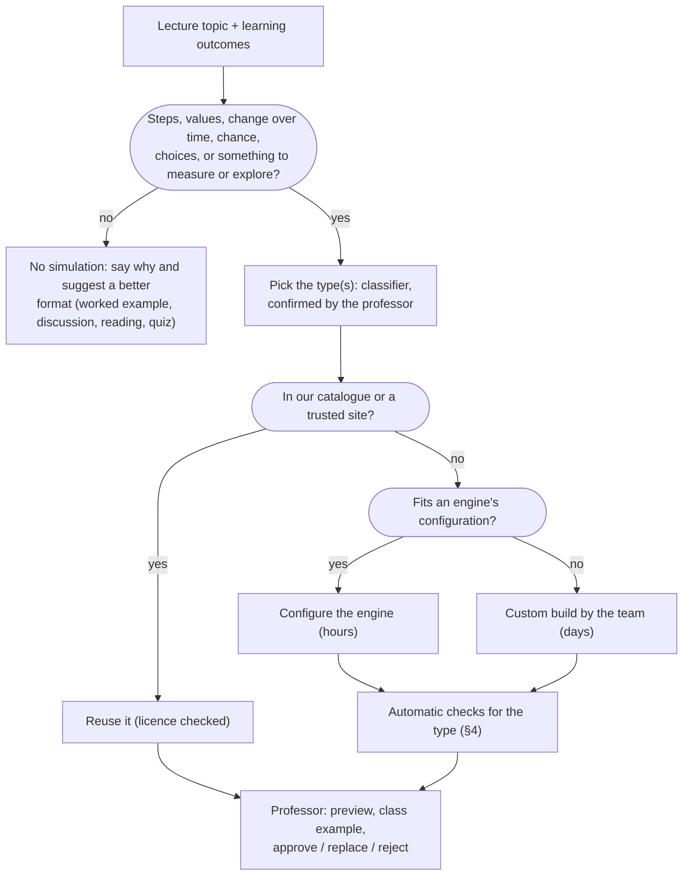
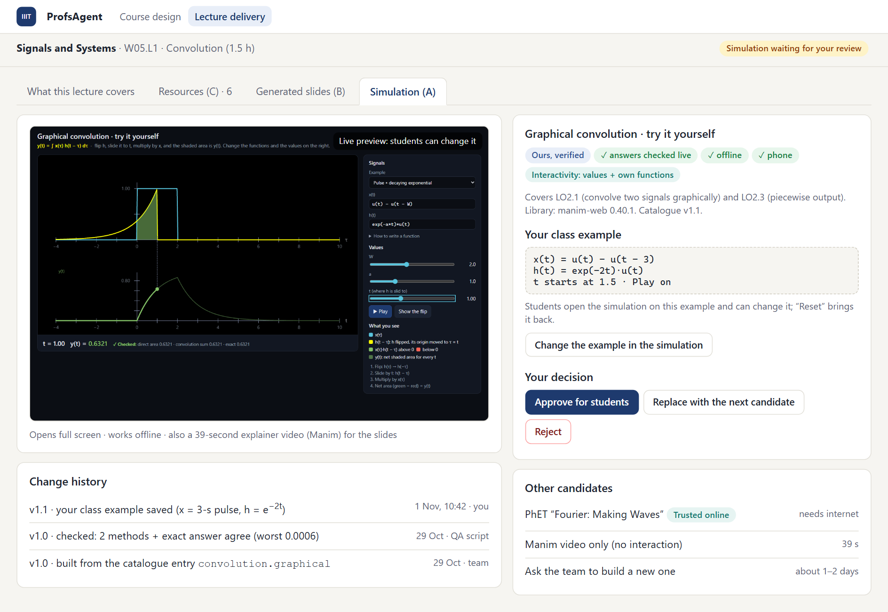
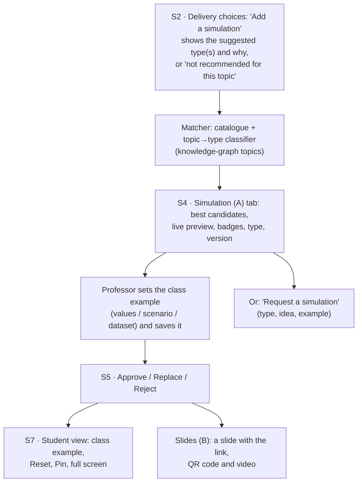

# ProfsAgent Phase 2 · Deliverable A: simulation catalogue and build plan for every kind of course

**Owner:** Amit · **Status:** v0.2, 2 Nov 2026 (v0.1 covered only maths, signals and ML); stage A1 and the app part of A2 built on 3 Nov · **Read with:** `05_phase2_A_simulations_and_tools.md` (the first simulations and tools), `04_phase2_UI_integration_guide.md` (Vihan's delivery screens) and `decisions.md`.

## 1. The idea in one paragraph

A university teaches hundreds of subjects, but students do only a few **kinds of things** in a simulation:
- step through a process;
- turn knobs and watch a curve change;
- watch a system evolve over time;
- watch chance and crowds;
- explore a network;
- look inside a machine;
- run code;
- explore data;
- turn a 3D model;
- make decisions in a scenario;
- run an experiment on themselves;
- explore maps, timelines and arguments.

So we classify every lecture topic by **what students would do**, not by its subject. Each of these **12 simulation types** gets one reusable engine, a way to check correctness that suits it, and a configuration format. A new simulation is then mostly configuration on a tested engine, which is how this scales to every department, at IIIT-D and at other universities later. Some topics are better taught another way; for those the system says so and suggests something better (§5).

## 2. What every simulation must satisfy (any type)

| Requirement | What it means in practice |
|---|---|
| **Correct** | Whatever can be computed comes from code and is checked by an independent method. Whatever can't be computed (arguments, history, ethics) is sourced and reviewed by the professor. The check method depends on the type (§4). |
| **Interactive** | At least level L2 (change values); L3–L4 where the type allows. Level L5 adds choices with consequences (scenarios, games). |
| **Trackable** | A link reproduces any state. The professor's class example and every new version are recorded with who and when (§8). |
| **Offline and portable** | One HTML file that opens by double-click, except where a server is unavoidable (multi-player classroom games, heavy compute). |
| **Fast and light** | Under about 50 ms per change; works on a phone; degrades to still frames on a weak device. |
| **Accessible and inclusive** | Keyboard and screen-reader support, colour-blind-safe palettes, a reduced-motion option, labels in English first with Hindi optional, and respectful handling of sensitive topics. |
| **Safe and private** | Student code runs in a sandbox. Attacks are practised only on simulated targets. A student's own experiment data stays on their device unless they agree to share it. |
| **Reviewable** | A professor approves a simulation, at a specific version, before students see it. |

**Interactivity levels:**
- L0: watch.
- L1: step, play, pause.
- L2: change values.
- L3: change the data or input.
- L4: change the functions, rules or code.
- L5: make choices that change what happens next (scenarios, games, role-play).

## 3. The 12 simulation types

| # | Type | What students do | Engine (library) | Typical subjects |
|---|---|---|---|---|
| 1 | **Step-through process** | Step forwards and backwards through a procedure, see the state and the code line, predict the next step | Own HTML/JS + SVG: a state-machine stepper with a step log and code highlighting | Algorithms, OS, networking protocols, DBMS, compilers, cryptography, biological processes, legal or business procedures |
| 2 | **Parameter explorer** | Turn knobs and type formulas; curves, areas and points update live | manim-web (Manim in the browser, MIT licence) | Maths, signals, physics formulas, economics curves, finance, antenna patterns, psychometrics |
| 3 | **Systems over time** | Set the starting conditions and watch the system evolve; compare runs | manim-web + our numerical solver (Runge–Kutta with step halving) | Circuits, control, mechanics, waves, enzyme kinetics, protein folding, predator–prey, epidemics, economic growth |
| 4 | **Chance and crowds** | Run many random trials or agents; see the averages emerge; change the rules | Own Canvas 2D + a seeded random generator + charts | Queues (OS, networks), packet loss, Monte Carlo, evolution and drift, opinion dynamics, segregation models, markets, traffic |
| 5 | **Networks and graphs** | Build or edit a network; run algorithms and measures on it | Own SVG for small graphs; Cytoscape.js (MIT) for large ones | Graph algorithms, routing, social networks, supply chains, biological pathways |
| 6 | **Machines inside** | Watch a component work at the bit, cycle or packet level and change its settings | Own JS models; reuse CircuitVerse (logic), Falstad (analogue circuits) and Wokwi (embedded) after a licence check | Digital logic, CPU datapath and pipeline, caches, paging, packet encapsulation, embedded systems |
| 7 | **Live code and query sandbox** | Write and run real code or queries safely in the browser, with hidden tests | Pyodide (Python, MPL-2.0), sql.js (SQLite, MIT), an assembly emulator; runs in a Web Worker with time and memory limits and no network | Programming, DBMS (SQL), compilers, security labs on fake targets, data-analysis practice |
| 8 | **Data explorer** | Load a dataset, filter and transform it, fit models, see the statistics change | Vega-Lite (BSD) or Plotly.js (MIT) + own statistics | Statistics, econometrics, biostatistics, psychology data, survey research, healthcare data |
| 9 | **3D and spatial models** | Rotate, cut and measure 3D structures; place things in space | three.js (MIT, already inside manim-web); 3Dmol.js (BSD) for molecules | Molecules and proteins, crystals, anatomy, mechanical parts, fields and antennas, XR and 3D design, geography |
| 10 | **Decisions, games and role-play** | Make choices in a scenario and see their consequences; play against strategies; talk to an AI partner with a role | Own scenario engine: a branching story with state, rules and payoffs computed by code (YAML); an optional AI role-play partner with guardrails and a rubric; multi-player via our app later | Ethics dilemmas, game theory, behavioural experiments, entrepreneurship, supply-chain games, communication and interviews, clinical and legal cases |
| 11 | **Experiments on yourself** | Take part in a classic experiment and analyse your own data (time, clicks, choices) | Own JS with accurate timing (`performance.now`) + analysis | Psychology (attention, perception, memory), HCI (Fitts' law), design (contrast, Gestalt, typography), perception of sound and colour |
| 12 | **Maps, timelines and arguments** | Explore events in time and space, map an argument and test whether it holds, annotate a text | Own SVG timelines and offline vector maps, an argument-map editor with a logic check, an annotation layer | History, sociology and anthropology, political science, philosophy, literature, law (precedents) |

**Composites** are built from these engines rather than as separate ones:
- **Virtual lab** = a step-through procedure (1) + a model (3 or 4) + instrument noise. Examples: titration, PCR and gels, oscilloscope measurements, fieldwork sampling.
- **Classroom game** = a scenario (10) + live multi-player through our app. Examples: a market, a public-goods game, a beer game.
- **Studio** = a design canvas with measured feedback (11 + 9). Examples: perspective drawing, layout grids, animation timing.

## 4. How each type is checked

| Type | Independent check | Example |
|---|---|---|
| 1 Step-through | A second implementation or a reference library, plus invariants after every step | Round Robin against a separate scheduler (808 cases); Dijkstra against Bellman–Ford |
| 2 Parameter explorer | Two numerical methods, plus the exact answer where one is known, live | Convolution: area vs convolution sum vs formula (worst 0.0006) |
| 3 Systems over time | Conservation laws; the exact solution in special cases; the same run with half the step size must agree | An RC circuit against its exponential; energy kept within a tolerance |
| 4 Chance and crowds | A fixed seed reproduces runs; averages against theory with confidence intervals; agreement improves with more runs | M/M/1 queue: the simulated mean wait against λ/(μ(μ−λ)) |
| 5 Networks | Results compared with a reference graph library (computed in Python beforehand) | Centrality or shortest paths against networkx |
| 6 Machines inside | Truth tables or a reference simulator; timing invariants | A cache's hit rate against a separate trace-driven simulator |
| 7 Code sandbox | Hidden test cases with expected outputs from a reference run; sandbox limits tested | SQL: the student's result set compared with the reference query's |
| 8 Data explorer | The same statistics from a second library, computed beforehand and shown side by side | A regression against statsmodels' output |
| 9 3D models | Geometry from authoritative data (e.g. the Protein Data Bank); measurements recomputed | Bond lengths and angles from the file |
| 10 Decisions and games | Payoffs and equilibria computed by code; an automatic scenario check (every branch reachable, no dead ends); the professor reviews the content; an AI partner follows a script and a rubric, never grades alone, and its transcripts are reviewable | Game theory: best responses computed, not written |
| 11 Experiments on yourself | Timing accuracy tested on the device; results compared with published effect sizes as sanity ranges; analysis code tested | Stroop: slower for mismatched colours, within the usual range |
| 12 Maps, timelines, arguments | Every fact carries a checked source (as our book references do); argument validity checked by a logic engine; professor review | An argument map: remove a premise and see whether the conclusion still follows |

## 5. Every situation the system must handle

### 5.1 From any lecture topic to the right outcome



### 5.2 Special situations

| Situation | What we do |
|---|---|
| **Nothing to simulate** (e.g. ethnographic method, the history of a field) | Say "no simulation recommended" with the reason, and offer a better format: worked example, annotated reading, discussion prompt, quiz, curated video. Never force one. |
| **Pure theory and proofs** (abstract algebra, topology) | Small visual examples (a group's Cayley table, symmetries of a polygon) and a proof stepper where steps can be revealed; otherwise none |
| **Lab courses** (hardware, wet labs, fieldwork) | A virtual lab for preparation and safety, never a replacement for the real lab; reuse Wokwi or Falstad for electronics |
| **Heavy computation** (training deep networks, large models) | Precomputed results to explore, plus a small live version; or a server job in our app with cached results |
| **Real datasets** | Licensed and anonymised data only; a small sample is bundled; the source is cited |
| **Running student code** | Inside a Web Worker with time and memory limits and no network; results checked by hidden tests |
| **Security topics** | Attacks only against targets simulated inside the page (a fake database or login), with an ethics note; never real systems |
| **Sensitive topics** (violence, gender, ethics, religion) | No "right answer" scoring or game-like rewards for harm; content notes; scenarios curated and approved by the professor; balanced, sourced positions |
| **AI role-play partners** (communication skills, interviews, negotiation, clinical history-taking) | A scripted persona and goal, guardrails against off-topic use, feedback against a rubric, the student's transcript kept private, and never AI-only grading |
| **Multi-player classroom games** (markets, voting, public goods) | Need our app as a server (a later phase); until then, single-player against computer strategies |
| **Different levels** (first year vs postgraduate) | The same simulation with different class examples, parameter ranges and hidden details |
| **Weak phones, slow internet** | A single offline file, under 50 ms per change, still frames as a fallback, no external fonts or CDNs |
| **Using simulations in assessment** | "Predict, then check" questions and tasks checked automatically inside the simulation; results go to the professor only with the student's consent |
| **Language and accessibility** | Text kept in a strings file (English, with Hindi optional); keyboard use, screen-reader readouts, colour-blind palettes and reduced motion are checked by the QA script |
| **A topic no type fits** | Custom build (the "custom" route in §5.1). If similar requests keep coming, it becomes a new type with its own engine. |

## 6. Coverage

### 6.1 Every IIIT-D department (475 catalogue courses; topics from our knowledge graph)

| Department (courses) | Main types | Examples from real IIIT-D weekly topics |
|---|---|---|
| CSE (133) | 1, 5, 6, 7, 4 | **OS (CSE231):** process scheduling and synchronisation (1), page replacement (1), queueing (4). **Networks (CSE232):** packet vs circuit switching, delay, loss and throughput (4), TCP (1), routing (5), encapsulation (6). **DBMS (CSE202):** SQL (7), normalisation and query processing (1), B+ tree (1). **Compilers (CSE601):** control-flow graphs and data-flow analysis (1, 5). **Computer Organization (CSE112):** IEEE 754, state machines (6, 1). **Network Security (CSE350):** AES rounds, RSA, Diffie–Hellman (1, 2) |
| ECE (76) | 2, 3, 6, 9 | **Digital Circuits (ECE111):** gates, Boolean algebra, De Morgan (6). **Antennas (ECE431):** wave propagation, radiation patterns (3, 9). **Signals (ECE250):** convolution, sampling (2). **Communication:** noise and errors (4) |
| Mathematics (66) | 2, 3, 4, 8, 9 | Linear algebra, probability, numerical methods, PDEs. Pure algebra and topology get small visual examples or a proof stepper (§5.2) |
| Design (42) | 11, 9, studio | **Design Drawing (DES101):** observation, perspective (studio). **HCI (DES204):** Fitts' law, interaction concepts (11). **3D animation and XR:** 3D models (9). **Cognition in design:** experiments (11) |
| Humanities (SSH, 37) | 10, 12 | **Applied Ethics (SSH321):** moral dilemmas, the ticking time bomb, euthanasia (10, with sensitive-topic rules). **Moral and political philosophy:** argument maps (12). **Gender sensitisation:** scenarios (10) |
| Biology (34) | 3, 9, 1, 8 | **Cell Biology and Biochemistry (BIO211):** enzyme kinetics (3), Ramachandran plots (9). **Biophysics (BIO361):** protein folding kinetics (3). Bioinformatics algorithms (1). Biostatistics (8) |
| Sociology (30) | 12, 4, 5, 10 | **Anthropology of Violence (SOC306):** violence, law and legitimacy (12: sourced timelines and argument maps; sensitive-topic rules). Anthropology of social media: networks (5). Segregation and influence models (4). Ethnographic methods: no simulation, a fieldwork worked example instead (§5.2) |
| Entrepreneurship (20) | 10, 2, 8 | **Entrepreneurial Finance (ENT413):** cash flow and runway decisions (10, 2), financial statements (8) |
| Economics (18) | 10, 2, 4, 8 | **Game Theory (ECO311):** strategic-form games, dominance and best response (10, equilibria computed). **Behavioural Economics (ECO314):** prospect theory and the zTree-style experiments it uses (10, 11). Econometrics and causal inference (8) |
| Psychology (8) | 11, 4, 8 | **Attention and Perception (PSY305):** attention as limited capacity, visual and auditory attention (11). **Social Psychology (PSY302):** influence and attitudes (4, 10) |
| AI (4) | 2, 7, 8 | Gradient descent, training curves, small notebooks |
| Communication (2) | 10, 11 | **Communication Skills (COM101):** speaking off the cuff, introducing yourself (10, AI role-play partner); timing and pace (11) |
| Environmental Science (2) | 3, 4, 12 | **Ecology, Evolution and Environment (ESC207A):** population dynamics (3), evolution and drift (4), fieldwork maps (12) |
| Management (2) | 10, 4 | **Supply Chain (MGT310):** the newsboy problem and multi-echelon supply chains (10: a beer game; 4) |
| Research Methods (1) | 8, 4 | Sampling, bias and significance (8, 4) |

### 6.2 Other universities (for when ProfsAgent is extended)

| Discipline | Main types | Examples |
|---|---|---|
| Physics | 2, 3, 9 (+ reuse PhET) | Projectiles, oscillators, optics, fields |
| Chemistry | 9, 3, virtual lab | Molecules, reaction kinetics, equilibrium, titration |
| Mechanical, civil, aerospace | 3, 9, 2, 4 | Vibrations, beam deflection, trusses, traffic flow |
| Electrical and power | 3, 6 | Transients, machines, power flow (reuse Falstad) |
| Medicine, nursing, pharmacy | 3, 9, 10 | Pharmacokinetics, anatomy, clinical case decisions |
| Law | 10, 12 | Moot-court branching cases, precedent graphs |
| Business, finance, accounting | 10, 2, 8, 4 | Business games, valuation formulas, markets |
| Architecture and planning | 9, 4, 11 | Daylight and acoustics, pedestrian flow |
| Languages and linguistics | 10, 11, 12 | Conversation role-play, phonetics, text annotation |
| History, political science, geography | 12, 10, 4 | Maps and timelines, negotiation games, voting models |
| Music, arts, film | studio, 11, 9 | Synthesis, colour, timing, 3D |
| Education, agriculture, environment | 10, 8, 3 | Classroom scenarios, crop and climate models |

### 6.3 Measuring coverage properly

A **topic → type classifier** labels all 8,025 topics in our knowledge graph with a type or "no simulation". It uses the local embedding model plus the course context, and is calibrated on about 200 topics labelled by hand, as we did for topic matching. The result is a coverage report per department, which also tells us which engines to build first.

## 7. The catalogue

### 7.1 What a catalogue entry records

Each simulation is a folder with its configuration or source, its QA script and a `sim.yaml`:

```yaml
id: signals.convolution.graphical
type: 2-parameter-explorer          # one of the 12 types (§3); composites list several
title: Graphical convolution · try it yourself
version: 1.1.0                      # approvals point to a version
status: team-checked                # draft | team-checked | retired  (professor approval is per course, in the app)
courses: [ECE250]
topics: [convolution, LTI systems]  # matched to the knowledge graph's topics by embedding
interactivity: L4
engine: {name: manim-web, version: 0.40.1, licence: MIT}
config: {parameters: [W, a, t], functions: [x(t), h(t)], examples: 5}
strings: {en: strings.en.json}      # Hindi etc. added as files
checks: {live: "two methods + exact answer", qa: {script: qa_convolution.py, last_run: 2026-11-01, result: pass}}
sensitive: false                    # true switches on the sensitive-topic rules (§5.2)
changelog:
  - {version: 1.1.0, date: 2026-11-01, by: Amit, change: "u(0) = 1/2; checks agree to 0.0006"}
```

### 7.2 Entries today

| ID | Type | Course | Level | Check | Status |
|---|---|---|---|---|---|
| `algorithms.graph.kosaraju` | 1 | CSE222 | L3 | mutual reachability | team-checked |
| `algorithms.graph.dijkstra` | 1 | CSE222, CSE102 | L3 | Bellman–Ford | team-checked |
| `os.scheduling.round_robin` | 1 | CSE231 | L2 | separate scheduler, 808 cases | team-checked |
| `dsa.stack.valid_parentheses` | 1 | CSE102 | L3 | pair removal, 3,012 strings | team-checked |
| `dbms.index.bplus_tree` | 1 | CSE202 | L3 | rule check, 630 runs | team-checked |
| `signals.convolution.graphical` | 2 | ECE250 | L4 | two methods + exact, live | team-checked |
| `ml.clustering.dbscan` | 1 + 8 | CSE343, AI201 | L3 (interactive) + video | identical to scikit-learn | team-checked |
| `os.memory.page_replacement` | 1 + 6 | CSE231 | L3 | a second implementation; textbook answers | team-checked |

These cover only types 1, 2, 6 and 8. The live catalogue is the `simulations/` folder (`python scripts/sims.py list`). The plan below builds the engines that open up the other departments.

### 7.3 First simulation per new engine (one per department group)

| Engine (type) | First simulation | Course | Independent check |
|---|---|---|---|
| 4 Chance and crowds | Packet queue: delay, loss and throughput vs load | CSE232 | M/M/1 and M/M/1/K formulas, with confidence intervals |
| 6 Machines inside | Cache and paging simulator (also covers page replacement) | CSE112, CSE231 | A separate trace-driven simulator |
| 7 Code sandbox | SQL playground with tasks | CSE202 | Result sets against the reference queries |
| 10 Decisions and games | Strategic-form games: dominance, best response, Nash equilibria | ECO311 | Equilibria computed by code |
| 10 (sensitive) | Applied ethics dilemmas with arguments and the class's responses | SSH321 | Professor-curated arguments, sources cited |
| 11 Experiments on yourself | Attention and perception lab (Stroop, change blindness, attentional blink) | PSY305 | Timing test; published effect ranges |
| 11 / HCI | Fitts' law: measure your own pointing | DES204 | Regression of time on the index of difficulty |
| 3 Systems over time | Enzyme kinetics (Michaelis–Menten) and protein folding | BIO211, BIO361 | Exact solution in special cases; half-step agreement |
| 10 + 4 | Supply-chain beer game and the newsboy problem | MGT310 | Optimal order quantity from the formula |
| 5 Networks | Social network measures on a class-built network | SOC (anthropology of social media) | networkx results |
| 12 Maps, timelines, arguments | Argument map with a validity check | SSH (moral philosophy) | Logic engine; sources |
| 9 3D models | Protein structure and the Ramachandran plot | BIO211 | Angles recomputed from the PDB file |
| 8 Data explorer | Regression and causal inference with a real dataset | ECO (econometrics) | statsmodels output |
| 10 + AI partner | Speaking practice with a role-play partner | COM101 | Rubric; transcript review |

## 8. Change and tracking

| Who changes it | What | Where it is recorded | Compare or undo |
|---|---|---|---|
| **A student** | Values, data, functions, choices | In the page's link (state after `#`), so any state can be shared and reproduced; nothing is stored on a server. Scenario choices are kept as a replayable path. | **Pin** keeps the current result faint to compare with the next. **Reset** goes back to the class example. **Recent tries** lists the last few states. Scenarios can be replayed. |
| **A professor** | The class example (values, functions, scenario branch, dataset) | `runs/<id>/delivery/simulations/<lecture>.json`, the change history on the Simulation tab, and Neo4j | Earlier class examples are kept and can be restored |
| **The team** | Engines, configurations, checks | Git, the `sim.yaml` version and change log, and `decisions.md` | An approval belongs to a version. A new version shows "Update available: what changed" and needs approval again. Nothing is replaced silently. |

## 9. How it fits into our app





| Screen (Vihan's guide) | What changes |
|---|---|
| S2 · Choices | **Add a simulation**, with the suggested type and the reason (e.g. "Decisions and games: students choose strategies and see the payoffs"), or **"Not recommended: try a worked example"**. The professor can choose another type. |
| S3 · Progress | "Finding a simulation…" (seconds for a catalogue match). A request creates a team task. |
| S4 · Results | The **Simulation (A)** tab (mock-up above): candidates, a live preview, badges (✓ checked · offline · phone · type · level · sensitive-topic rules on), learning outcomes covered, class example, change history. |
| S5 · Review | Approve / Replace / Reject, recorded as review kind `simulation`. |
| S7 · Students | Approved simulations open on the class example. Scenarios and experiments keep the student's data on their device. |
| S8 · Feedback | 1–5 stars and "did it help?". The weekly health check re-checks linked online simulations. |
| New: Catalogue page | Browse by department, type and course: what exists, what's planned, what's been requested. |

**Built in the app on 3 Nov (decisions.md 26).** Two changes from the proposal: the simulation is its own card on the lecture page rather than a sixth delivery choice, and its data stays in the app's files, so Vihan's survey and review files are unchanged.
- **Lecture page:** a **Simulation** card, above Results. It shows:
  - the catalogue entries whose title or topics match the lecture topic, found with the local model and no AI calls;
  - when nothing matches, the kind of simulation the topic suits, or "no clear fit";
  - **Try it**, which opens a large preview window;
  - **Approve / Replace / Reject**, with a reason required to reject, and Undo;
  - **Add one from the catalogue** and **Ask for a new simulation**.
- **Class example:** inside the preview window, **Use this setup as the class example** saves the setup that is on screen. Students then start from it.
  - Pages report their setup through `simulations/_engines/share/share.js`. Today that is the stepper engine, convolution and DBSCAN; the other five say they cannot keep one yet.
- **Approvals and versions:** an approval is stored with its version. When the version changes, the card says "Updated since you approved it".
- **Student view:** shows the approved simulations, first in each lecture, opened at the class example.
- **Lecture list:** "Simulation" and "Simulation suggested" chips.
- **Simulations page** (top menu): a search box and the list of entries to try, with **Ask for a new simulation** at the top and the professor's requests at the bottom. The kinds and course filters stay internal; a professor does not need them.
- **API:**
  - `GET /api/simulations`;
  - `GET /api/simulations/<id>/page`, served with `Content-Security-Policy: sandbox allow-scripts …; connect-src 'none'`, so the page gets its own origin and no network;
  - `POST /api/simulations/requests`;
  - `POST /api/delivery/<run>/simulations/<lecture>` (add, approve, replace, reject, undo);
  - `…/class-example`.
- **Data:**
  - `runs/<id>/delivery/simulations/suggestions.json` is remade when the lectures or the catalogue change;
  - `decisions.json` holds the added entries, decisions, class examples and history;
  - `runs/_simulation_requests.json` is not committed.
- **Links to trusted sites (decisions.md 27):**
  - each lecture also gets up to 3 links to simulations on PhET, Falstad, VisuAlgo, Python Tutor, CircuitVerse, TensorFlow Playground, CNN Explainer or Seeing Theory, from `simulations/external/index.json` (377 links; similarity ≥ 0.65);
  - they are links only, marked "External, not checked by us"; the professor opens, approves or rejects them;
  - a rejection reason starts the request for a new simulation.
- **Search before building (decisions.md 29):** a request first looks for existing simulations:
  - our catalogue and the saved links;
  - a web search, trusted sites first (Virtual Labs, PhET, VisuAlgo…), then the open web;
  - the top 3 pages of each search are opened in Chrome and checked for controls and the topic.
  - The professor approves or rejects what was found (with screenshots). Only when nothing fits does the machine build one.
- **Auto-build (decisions.md 28):** a professor's request is built by the machine when it can be.
  - One AI call writes a recipe for the step-by-step engine, and the automatic checks in `_engines/stepper/qa_recipe.py` accept it or send the problems back (3 attempts at most).
  - What passes becomes `simulations/auto.<topic>/` (a draft, built by the machine); what fails goes to the team.
  - Tower of Hanoi and Selection Sort were the first two (3 Nov).
- **Not built yet:** stars and "did it help?" (S8), the slide link (B), Neo4j, and the survey and review keys in Vihan's files.

**Technical integration (the original proposal):**
- `GET /api/simulations` returns the catalogue. Pages are served at a fixed version in a sandboxed frame (`sandbox="allow-scripts"`, no network). Each engine's library is one shared, cached file; single-file builds are for offline sharing.
- **Data:** `runs/<id>/delivery/simulations/<lecture>.json` holds `{items: [{catalogue_id, type, version, source, class_example, decision, by, at}], requests: [...], history: [...]}`.
- **Neo4j:**
  - `(:Simulation {id, type, version})-[:TEACHES]->(:Topic)`;
  - `(:Delivery:Simulation)-[:FOR_LECTURE]->(:D_Lecture)` and `-[:USES]->(:Simulation)`.
- **Repo:** a `simulations/` folder with `_engines/` (one per type, each with its configuration schema and tests), `_lib/` (pinned libraries) and one folder per entry. Builds are generated by a script and kept out of git.
- **Agreement needed:**
  - **Vihan:** survey keys `simulation` and `sim_note`, review kind `simulation`, graph labels;
  - **Parth:** the simulation slide.

## 10. Risks

| Risk | Handling |
|---|---|
| Too many engines to maintain | Engines are built in order of coverage (§11), and composites reuse engines rather than adding new ones |
| A young library (manim-web) | Pinned version and bundled copy; our own JS as the fallback |
| Wrong content in non-computational types (ethics, history) | Sourced facts, professor curation and approval, no scoring of opinions |
| AI role-play going wrong | A scripted persona, guardrails, a rubric, private reviewable transcripts, no AI-only grading |
| Students' personal data (experiments, transcripts) | Kept on the device unless the student agrees to share it; anonymised if shared |
| Unsafe code or attacks | Sandbox limits and simulated targets only, both tested |
| Licences of reused sites and libraries | Checked before reuse; notices shipped with every page |
| Forcing simulations where they don't help | "Not recommended" is a valid, explained outcome; professors decide |

## 11. Plan (engines in order of how many departments they open)

| Stage | Engines and work | Departments opened |
|---|---|---|
| A1 (weeks 1–2) — **done 3 Nov** | Catalogue folder and `sim.yaml` for the 7 entries; step-through engine (1) made configurable; parameter explorer (2) with the DBSCAN interactive; topic → type classifier with a hand-labelled sample. **Result:** `simulations/` with 8 entries, all passing `scripts/sims.py qa`; the stepper engine + page replacement (CSE231); the DBSCAN interactive (manim-web); the classifier (73% cross-validated on 165 labels) and `simulations/coverage.md` | CSE, ECE, Maths (first coverage report) |
| A2 (weeks 3–4) — **app integration done 3 Nov** | **Decisions and games (10)**, including the sensitive-topic rules; **experiments on yourself (11)**; app integration (suggestions, Simulation card, class examples, review, Simulations page, student view) — **done** | Economics, Entrepreneurship, Management, Humanities, Psychology, Design, Communication |
| A3 (weeks 5–6) | Chance and crowds (4) and networks (5) as engines; machines inside (6); code sandbox (7) | CSE (OS, networks, DBMS, architecture), Sociology, Environmental Science |
| A4 (weeks 7–8) | Data explorer (8), 3D models (9), maps, timelines and arguments (12); virtual-lab composite; student view, slides link, Neo4j | Biology, Econometrics, Sociology, Philosophy, labs |
| A5 (later; the auto-build for step-by-step simulations was built on 3 Nov, decisions.md 28) | Multi-player classroom games through the app; the AI role-play partner; the "simulation skill" (the AI drafts configurations, the checks decide); Hindi strings; usage analytics with consent | All, and other universities |
| A6 (later, Amit's idea, 2 Nov) | **AI simulation suggestions from the slides:** read a lecture's slide material (Parth's deck: titles, bullets, figures, notes), find the moments a simulation would help explain (a process, a formula with parameters, a trade-off), and suggest a catalogue entry or a new configuration for that slide, which the professor accepts or rejects | All |

**Decisions needed:**
1. Is this list of 12 types and the engine order right?
2. Which department goes first after CSE/ECE? (I'd suggest Economics and Psychology: high value, and engines 10 and 11 then open many others.)
3. The rules for sensitive topics and the AI role-play partner (§5.2).
4. The `simulations/` repo layout, and states as links.
5. The screen and data proposal, to agree with Vihan and Parth.
