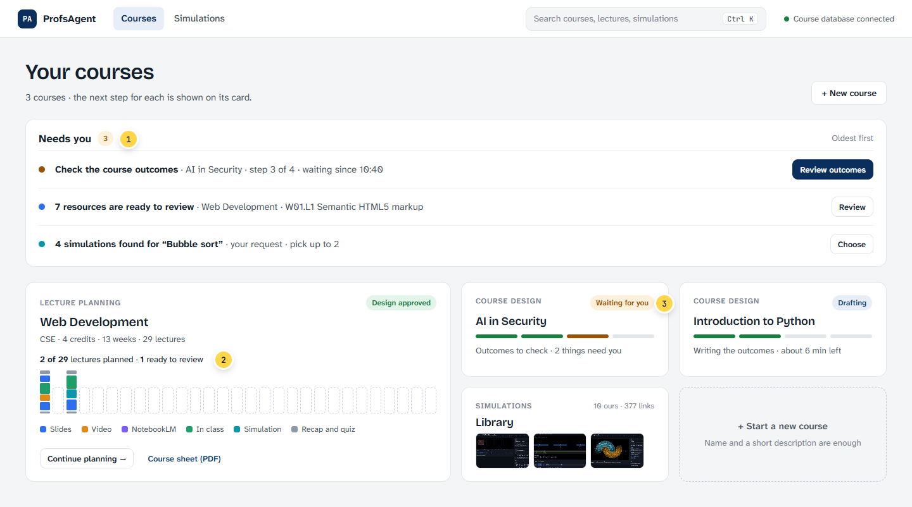
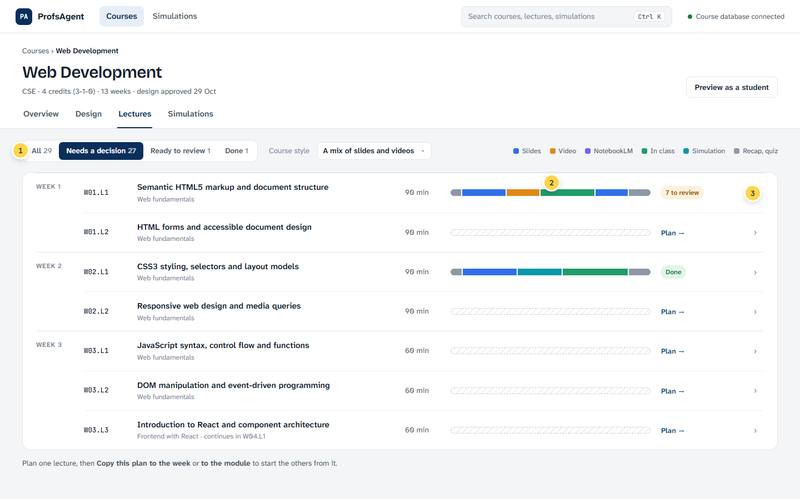
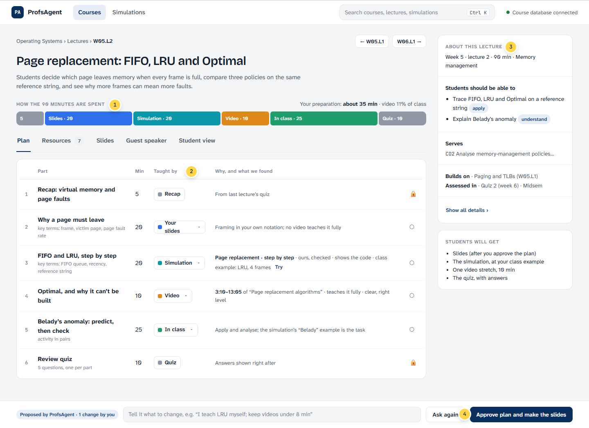
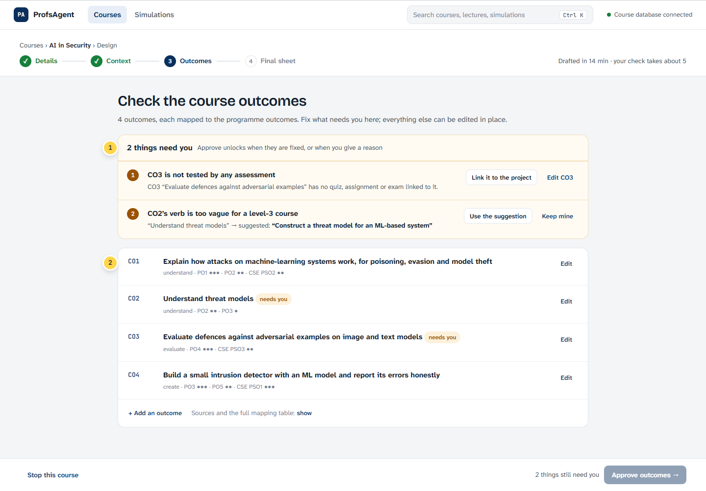
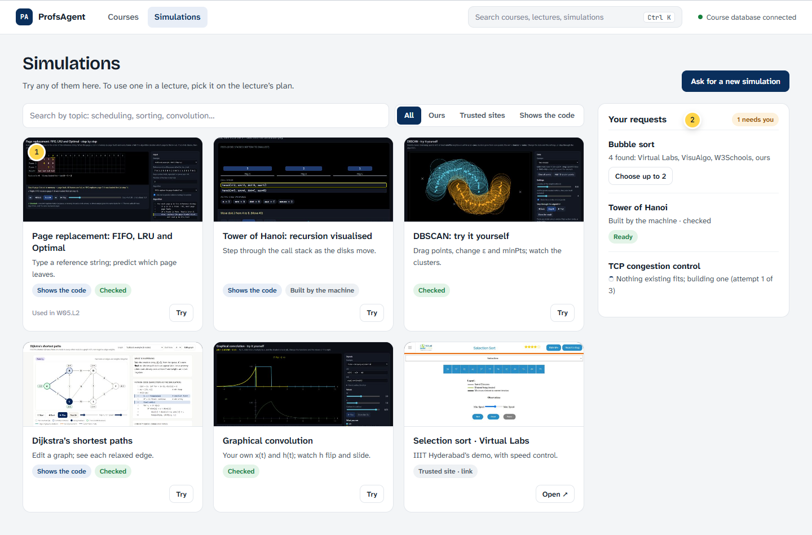
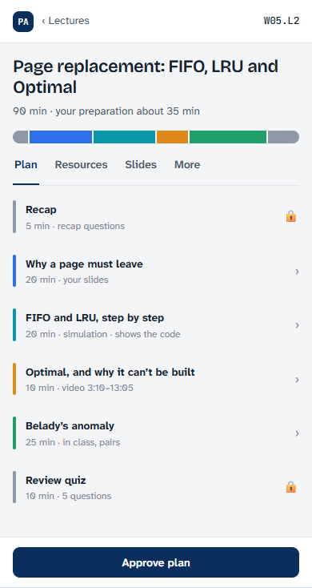

# ProfsAgent UI improvement plan: less to read, one decision at a time

**Owner:** Amit · **Status:** proposal v0.1, 3 Nov 2026, for Amit's decision · **Covers:** the professor app (`src/profsagent/app/`): course design, lecture delivery, simulations, student view · **Read with:** `docs/decisions.md` 30 (the lecture mix), `docs/09_phase2_A_simulation_catalogue.md`.

## 1. The idea in one paragraph

The app works, but it shows almost everything at once.
- The lecture page is five screens tall: 1,367 words, 41 buttons and 20 inputs.
- The lecture list repeats the same tag on all 29 lectures.
- The Simulations page has 16 primary buttons of equal weight.

The redesign keeps every feature but changes what is shown first:
- **One queue** of what needs the professor.
- **One primary action** per screen.
- **Details on demand.**
- **A single visual language for class time,** the *class-time bar*. It shows how each lecture's minutes are spent and reads the same on the home page, the course page and the lecture page.

The style is **calm minimalism**: bento tiles on overview pages, plain lists and tables where the professor works.

## 2. What we measured today (3 Nov, 1440 × 900 screen)

| Screen | Height (screens) | Words | Buttons | Primary buttons | Chips | Inputs |
|---|---|---|---|---|---|---|
| Your courses | 1.0 | 59 | 8 | 1 | 3 | 0 |
| New course form | 2.6 | 359 | 31 | 1 | 1 | 21 (2 required) |
| A finished course | 4.4 | 870 | 35 | **3** | 8 | 2 |
| Lecture list (29 lectures) | 3.7 | 856 | 4 | 0 | **77** | 4 |
| **Lecture page** | **4.9** | **1,367** | **41** | 1 | 17 | **20** |
| Simulations | 3.3 | 901 | 22 | **16** | 30 | 1 |

**The ten problems that cost the most attention:**

| # | Where | Problem | Principle it breaks |
|---|---|---|---|
| 1 | Lecture page | Everything at once: summary, 8 detail boxes, 5 delivery choices with their options, progress, simulation, and 7 result tabs | Progressive disclosure; Miller's chunking |
| 2 | Lecture list | "★ New topic" on all 29 lectures: a tag on everything tells nothing. "Not decided" on 28 rows | Signal-to-noise; aesthetic and minimalist design |
| 3 | Lecture list | Up to 5 chips per row (choices, status, slides) | Recognition over recall: one status, in words |
| 4 | Finished course | 3 dark primary buttons together. A red "15 open errors" alarm under "Your course is ready" | One primary action; consistency; match with the real world |
| 5 | Everywhere | System words: "C", "B", "Material team (B)", "deliverable", "D6", "V23", "gate" | Speak the user's language |
| 6 | Navigation | Course design, Lecture delivery and Simulations are three top-level places; delivery asks you to pick the course again | Jakob's law; minimise the user's memory load |
| 7 | Simulations | 16 equal primary buttons; text-only cards | Visual hierarchy; recognition (pictures) over reading |
| 8 | Course checks | Problems are listed after the content, and fixes are a separate edit step | Error prevention and recovery; fix where you see it |
| 9 | Waiting | Long jobs (AI fill, searches, builds) show different progress styles on each screen | Visibility of system status; consistency |
| 10 | Phone | Usable, but the lecture page is about 14 screens long on a phone | Flexibility; Fitts's law (targets near the thumb) |

## 3. Principles, as rules we can check

| Principle | Rule for this app | How we check it |
|---|---|---|
| One decision per screen | Each screen has exactly **one** primary button; everything else is secondary or a quiet link | Count `.btn.primary` = 1 in the QA run |
| Progressive disclosure | A screen shows what is needed for its decision. Details open on demand: side panel, "Show all", a tab | The lecture page above the fold holds the summary, the class-time bar and the plan |
| Chunking (Miller, Hick) | At most about 7 items in any visible group; long lists get filters with counts | Filters as a segmented control with numbers |
| Recognition over recall | Pictures for simulations, the class-time bar for lectures, the course named on every screen | Every list item shows a thumbnail or a bar |
| One status in words | One status per item, from a fixed vocabulary: *Needs you · Ready to review · Working · Done · Stopped* | No row has more than 2 chips |
| Plain language | No system codes in the UI (no C, B, D6, V23, gate). Sentence case. Buttons say what happens ("Approve plan and make the slides") | A copy lint in the QA run looks for the code words |
| Visibility of status | One progress pattern for every long job: what is happening, roughly how long, can I leave? | The same component everywhere |
| Error prevention | Problems appear first, each with a one-click fix; destructive actions ask once; everything can be undone | Every "needs you" item has a fix button |
| Word budget | Card intro ≤ 25 words; help text ≤ 15 words; one idea per sentence | Word counts in QA |
| Fitts and touch | Primary actions sit in a sticky bar at the bottom on long screens; targets at least 32 px (44 px on a phone) | Measured in the phone QA run |

## 4. Which visual style

| Style | Fit for professors planning a semester | Verdict |
|---|---|---|
| **Minimalism** | Calm, fast to scan, accessible, ages well; matches long working sessions | **Base style** |
| **Bento grid** | Great for overviews (courses, the simulation library): chunked tiles of different sizes | **Use on overview screens only** |
| Glassmorphism / Liquid Glass | Blur and translucency lower text contrast. They suit an operating system's chrome, not data-dense forms, and blur costs battery on laptops | Avoid (at most a frosted sticky bar) |
| Neumorphism | Soft shadows make buttons hard to tell from the background; fails contrast (WCAG) | Avoid |
| Skeuomorphism | Dated; real-object textures add noise | Avoid; keep only real metaphors such as the timeline |
| Claymorphism | Playful and toy-like; lowers credibility with faculty | Avoid |
| Brutalism | Harsh, deliberately "unfinished"; low trust for an academic tool | Avoid |
| Maximalism | The opposite of reducing load | Avoid |
| Spatial UI | Needs headsets and 3D; nothing in our tasks needs depth | Not now (maybe later for 3D simulations) |

**Recommendation:** calm minimalism, with bento overviews and one signature element, the class-time bar. Motion is quiet and fast (section 6).

## 5. The design system

**Colour** (cool paper, not cream; IIIT-D navy for actions; six colours that mean ways of teaching, always with a text label):

| Role | Value | Role | Value |
|---|---|---|---|
| Paper (background) | `#F3F5F7` | Slides | `#2F6FEB` |
| Card | `#FFFFFF` | Video | `#E0891B` |
| Ink / secondary / faint | `#16202C` / `#4B5665` / `#7A8594` | NotebookLM | `#7C5CFA` |
| Lines | `#E2E6EB` | In class | `#1F9D6B` |
| Action (IIIT-D navy) | `#0A2F5C` | Simulation | `#0A97AA` |
| Needs you / done / error | `#9A5205` / `#16803C` / `#B42318` | Recap and quiz | `#8E98A6` |

**Type** (bundled with the app as OFL font files, so it works offline):
- **Atkinson Hyperlegible Next** for body text. The Braille Institute designed it so similar letters (l/I/1, 0/O) can't be confused, which helps tired readers.
- **Bricolage Grotesque** only for page titles: one place with character.
- **JetBrains Mono** for codes (`W03.L2`, `CO2`, `CSE201`), so codes never look like words.

**Components:** a button hierarchy (primary, secondary, quiet), chips (at most 2 per item), the status vocabulary, a segmented filter with counts, a side panel, the sticky decision bar, one progress pattern, a toast, an empty state, and the **class-time bar**:
- **Small:** in lists, 12 px, no labels.
- **Big:** on the lecture page, labelled with minutes.
- **Score:** the stacked columns on a course tile.
- **Not planned:** a dashed outline instead of colour.

## 6. Motion and polish (Emil Kowalski's rules)

- UI motion stays under 200–250 ms, with ease-out curves, never ease-in.
- No animation on things people do many times: filtering, typing, ticking.
- Toasts slide in from the bottom and can be dismissed; menus open from their trigger.
- Pressed buttons scale to 0.98.
- `prefers-reduced-motion` gets fades, not movement.
- Skeleton rows while data loads, so the layout never jumps.

## 7. Information architecture

```
Before                                   After
Course design | Lecture delivery |       Courses | Simulations                 (+ search: Ctrl K)
Simulations                              ├─ Your courses: "Needs you" queue + course tiles
├─ courses (design runs)                 ├─ A course: Overview · Design · Lectures · Simulations
├─ delivery: pick the course again       │   └─ A lecture: Plan · Resources · Slides · Guest speaker · Student view
│   └─ lecture page (one long page)      └─ Simulations library: search, pictures, requests beside it
└─ simulations page
```

The course becomes the place you work in; delivery stops being a separate place where you pick the course again. Every old link (`#/run/…`, `#/delivery/…`) redirects to its new place.

## 8. The screens (mock-ups with real content)

**Your courses.** (1) One "Needs you" queue across all courses, oldest first, each item with its button. (2) The semester score: one column per lecture, coloured by how its minutes are spent, dashed when not planned yet. (3) Each tile names its next step; only the first queue item is a primary button.



**A course's lectures.** (1) Four filters with counts replace three dropdowns and a checkbox. (2) Each lecture's class-time bar shows at a glance which lectures are planned and how. (3) One status per lecture, in words; "★ New topic" appears only when it tells you something.



**A lecture.** It follows Vihan's mix proposal and adds simulations (decisions.md 30).
1. The big class-time bar, with minutes, the professor's preparation time and the video share.
2. One row per part, with **Taught by** as a menu, the evidence ("3:10–13:05 · teaches it fully", "ours · shows the code"), and a lock.
3. The details (learning outcomes, prerequisites, assessment) move to a side panel.
4. One sticky decision at the bottom: approve, or ask again with a note. Nothing is generated before it.



**A course design check (Outcomes).** (1) What needs the professor comes first, each item with a one-click fix ("Link it to the project", "Use the suggestion"); Approve unlocks when they are fixed or a reason is given. (2) Outcomes read as sentences; the mapping stays one quiet line, with the full table on demand.



**Simulations.** (1) A picture of every simulation, so it is recognised, not read; one quiet button per card; the labels "Shows the code" and "Checked". (2) Requests and their progress sit beside the library.



**The lecture on a phone.** One column; the parts as a list with their colour stripe; the decision in a thumb-reach bar.



## 9. Words: one vocabulary

| Now | After |
|---|---|
| C, B, deliverable, Material team (B) | Resources, Slides (no team names in the UI) |
| D6 "teaches_fully / teaches_partly" | "teaches it fully" / "teaches part of it" |
| gate1_context … gate3_proposal | Context, Outcomes, Final sheet (steps 2–4) |
| V23, VK-CONFLICT, VCO-BL | The problem in a sentence, with its fix |
| "Continue despite 15 open problems" | "15 things were left open: see them" (amber, never red after approval) |
| Not decided | Plan → (an action, not a state) |

## 10. How we use the skills you found

| Skill | What it is | Where it helps us | Install (optional) |
|---|---|---|---|
| **Impeccable** (Paul Bakaus) | Design vocabulary for coding agents: `critique` (heuristic scores), `audit` (accessibility, performance, responsive, P0–P3), `distill`, `quieter`, `polish`, an anti-pattern detector | Before and after each phase: critique and audit every screen; `distill` for the lecture page; `polish` before release | `npx impeccable install` |
| **Taste-skill** (Leon Lin) | Art direction and a real-browser self-check against generic AI pages; has a `minimalist-skill` variant | Guards the chosen direction while building; the browser self-check matches our Playwright QA | `npx skills add https://github.com/Leonxlnx/taste-skill --skill "design-taste-frontend"` |
| **Emil Kowalski** (emil-design-eng) | Design engineering: motion decisions, component polish (Sonner-style toasts), before/after reviews | Section 6; reviews of the toast, panel, menu and bar | `npx -y skills add emilkowalski/skill --skill emil-design-eng --agent claude-code` |
| **Superpowers** (obra) | Workflow: brainstorm → written design → bite-sized plan → build with tests → review | The process for each phase: this document is the brainstorm and design step | `/plugin marketplace add obra/superpowers-marketplace` |
| **21st.dev** | A marketplace of shadcn/React components and an MCP that fetches or generates them | **Patterns only:** our app is plain JavaScript (no React), so we copy the idea (command palette, segmented control, drawer, toast) rather than the code, unless we change the stack (section 12) | Needs a 21st.dev API key |
| **task-observer** | A meta-skill that logs corrections during work and turns them into better skills | Keeps the UI rules we agree on as a reusable skill. The same idea, inside the app: time key tasks (locally) to measure load before and after | `npx skills add https://github.com/rebelytics/one-skill-to-rule-them-all --skill task-observer` |
| **claude-mem** | Memory across Claude sessions | Optional: we already keep `decisions.md`, `CLAUDE.local.md` and Claude's memory | `npx claude-mem install` |
| **find-skills** (Vercel) | Finds and installs other skills | One-off: e.g. an accessibility or UX-copy skill (this session already has design:accessibility-review and design:ux-copy) | `npx skills add vercel-labs/skills@find-skills` |
| **Higgsfield** | An AI video and image studio, not a UI tool | Not for the interface. Maybe later for a 60-second "how it works" video or empty-state illustrations (paid) | — |

**Recommendation:** install **Impeccable** and **Emil Kowalski's skill**. They cover review and polish, and they don't overlap with what this session already has (frontend-design, design critique, accessibility review, UX copy). Skip claude-mem and Higgsfield for now.

## 11. How the change is built

- **Plain JavaScript stays** (no build step, works offline).
- **`index.html` is split** (about 1,750 lines today) into `app.css` plus a few ES modules: `ui.js` (components), `design.js`, `lectures.js`, `simulations.js`, `student.js`. FastAPI serves them as they are.
- **Fonts** are bundled in `static/fonts/` (OFL licences kept).
- **Tokens** become CSS variables in one place; the class-time bar is one function used by every screen.
- **Two versions side by side:** `?ui=2` turns the new screens on, so both can be compared with real courses before switching.
- **The server API is unchanged;** the "Needs you" queue gets one new endpoint that gathers waiting items across courses.
- **QA:** the Playwright scripts gain the checks from section 3: one primary button, chip count, word budgets, copy lint, phone, contrast.

## 12. Plan by phases

| Phase | What ships | Effort | Done when |
|---|---|---|---|
| 0. Foundations | Tokens, fonts, button and chip rules, status vocabulary, the class-time bar; `index.html` split into modules | 2–3 days | Every current screen still passes its QA |
| 1. Navigation and home | Course workspace and tabs, "Needs you" queue, course tiles with the semester score, Ctrl K search | 2 days | A professor reaches any waiting item in 1 click |
| 2. Lecture page | Class-time bar, plan table (read-only first: delivery mix phase 1), side panel for details, tabs, sticky decision bar | 3–4 days | Above the fold: summary, bar and plan; ≤ 350 words before any click |
| 3. Course design checks | Problems first with one-click fixes, outcomes as sentences, amber not red after approval | 2–3 days | Every problem has a fix button |
| 4. Simulations and student view | Library with pictures, requests beside it; student view in lecture order (recap → parts → quiz) | 2 days | One primary per screen |
| 5. Polish | Motion, empty and error states, phone layouts, accessibility audit (WCAG 2.2 AA) | 2 days | Impeccable `audit` has no P0 or P1 findings |
| 6. Test with professors | 3–5 professors, 5 tasks each (below); fix what they trip on | 1 week | Targets in section 13 met |

## 13. How we know it worked

- **Targets** (against section 2):
  - lecture page: ≤ 1.5 screens before any click, ≤ 350 words, 1 primary button;
  - lecture list: ≤ 2 chips per lecture;
  - Simulations: 1 primary button;
  - every long job uses the same progress pattern.
- **Five tasks** for a usability test, timed, thinking aloud:
  1. Find what needs you today.
  2. Fix the outcome problem and approve.
  3. Plan W03.L2 and approve it.
  4. Give a lecture a simulation, with a class example.
  5. See what students will get for week 3.
- **Scores:** SUS ≥ 80 (good); NASA-TLX mental demand lower than today's baseline; errors per task; time per task.
- **In the app** (the task-observer idea, kept on the laptop): how long each step takes from opening to deciding, before and after.

## 14. Decisions for Amit

- [ ] Accept the style: calm minimalism, bento overviews, and the class-time bar as the signature?
- [ ] Course-centred navigation (Courses | Simulations), replacing the three top-level sections?
- [ ] Keep plain JavaScript (recommended), or move to React/Preact to use 21st.dev components directly?
- [ ] Install Impeccable and Emil Kowalski's skill?
- [ ] Start with phase 0 + 2 (foundations and the lecture page), since the lecture page costs the most attention and is also where Vihan's mix lands?

## Sources

- Impeccable: [github.com/pbakaus/impeccable](https://github.com/pbakaus/impeccable)
- Taste-skill: [github.com/Leonxlnx](https://github.com/Leonxlnx)
- Emil Kowalski's skill: [announcement](https://x.com/emilkowalski/status/2033543717890465985), [emil-design-eng](https://skillselion.com/skills/emilkowalski/skills/emil-design-eng)
- Superpowers: [github.com/obra/superpowers](https://github.com/obra/superpowers)
- claude-mem: [github.com/thedotmack/claude-mem](https://github.com/thedotmack/claude-mem)
- find-skills: [Vercel docs](https://vercel.com/docs/agent-resources/skills)
- task-observer: [skillselion guide](https://skillselion.com/guides/task-observer-skill-claude-code-guide)
- 21st.dev Magic MCP: [github.com/21st-dev/magic-mcp](https://github.com/21st-dev/magic-mcp)
- Higgsfield: [higgsfield.ai](https://higgsfield.ai/about)
- Measurements and screenshots: `Temporary/ui_plan/audit_shots.py` (local); mock-ups: `Temporary/ui_plan/mockups.html` (local)
